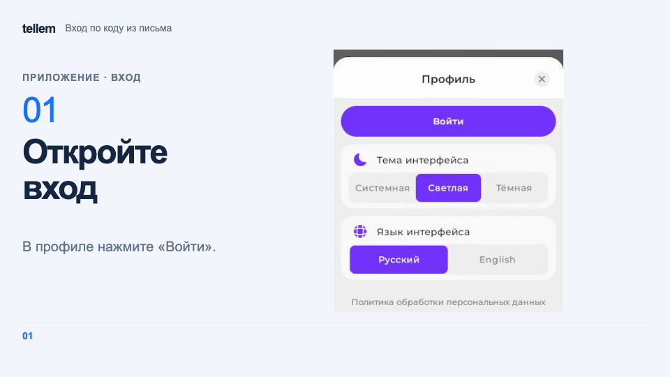
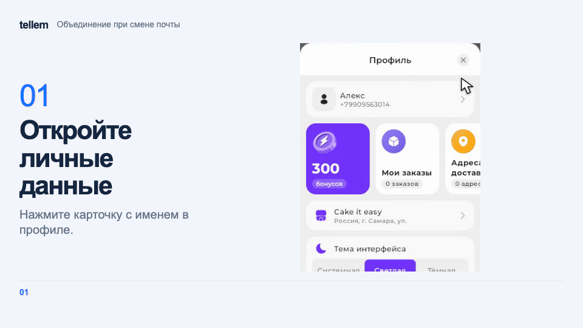
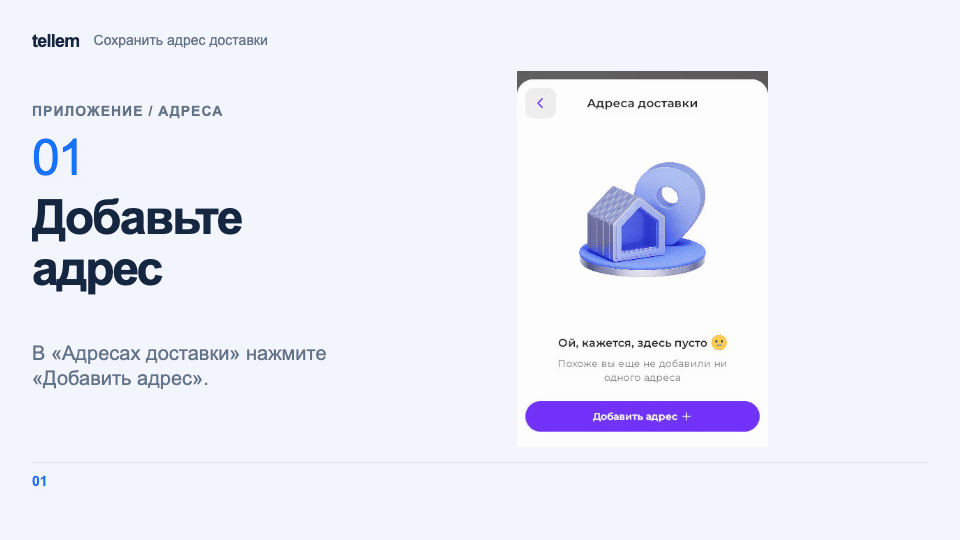

# Аккаунт, установка и уведомления { #account-installation-and-notifications }

Войдите в аккаунт, чтобы оформить заказ, сохранить адреса и подключить бонусы. Без входа можно [выбирать товары и собирать корзину](ui-and-pages.md).

## Профиль { #profile }

Откройте профиль кнопкой в шапке главного экрана. Карточка с именем ведёт в «Личные данные»; рядом находятся «Мои заказы», «Адреса доставки» и бонусы, если магазин их подключил. Контакты магазина ищите в «Поддержке»: этот пункт есть, если владелец добавил контакты.

??? example "Пример: верх профиля"

    Пример с демонстрационными данными.

    <figure markdown="span">
    [{ width="1280" height="720" loading=lazy }](../../media/app/app-profile-overview.png)
    </figure>

В профиле можно выбрать зону продаж, язык и тему интерфейса. Язык при первом открытии зависит от Telegram или браузера; после входа ваш выбор сохраняется в аккаунте. Тема «Системная» следует настройке устройства, «Светлая» и «Тёмная» задаются вручную. Тема Telegram в приложение не передаётся.

## Вход и регистрация { #sign-in-and-registration }

Откройте профиль и нажмите «Войти». В форме «Вход или регистрация» укажите e-mail, нажмите «Получить код», введите шестизначный код из письма и нажмите «Войти». После входа откроется ваш профиль. Новый аккаунт создаётся после подтверждения кода. Если код истёк или перестал приниматься после неверных попыток, запросите новый; время до повторного запроса видно на экране. При первом входе по коду вы получите письмо с автоматически созданным паролем.

Если приложение сообщает, что почта не подтверждена, войдите через привязанный сервис. Если войти не получается, обратитесь в магазин.

???+ example "Пример: вход по коду из письма"

    Пример с демонстрационными данными.

    <figure markdown="span">
    [{ width="960" height="540" loading=lazy }](../../media/app/app-sign-in-email.gif)
    </figure>

Флажок «Получать информационные рассылки магазина» включён по умолчанию и учитывается только при создании аккаунта. Позже подписку можно изменить в [настройках уведомлений](customer-notifications.md#mailings).

Другие способы входа:

- **«Войти по паролю»** — используйте e-mail и пароль. «Забыли пароль?» отправляет код для сброса. Новый запрос отменяет прежний код. Новый пароль должен содержать не менее 8 символов. После сброса все прежние сессии завершаются.
- **Telegram, VK ID и Yandex** — выберите доступную кнопку над формой. Для Telegram запустите бота магазина, нажмите **«Подтвердить вход»** и вернитесь в приложение. Если Telegram не открылся, нажмите «Telegram не открылся? Перейти по ссылке». Если время подтверждения истекло, начните вход заново.

Если выбранная до входа зона продаж ещё доступна, она заменит сохранённую в профиле, в том числе при входе через VK ID или Yandex.

В Telegram Mini App, то есть приложении внутри Telegram, вход проходит через аккаунт Telegram. Пароль, «Активные сессии», «Выйти», привязка Telegram и push там недоступны. Для управления ими откройте ссылку магазина в браузере и войдите кнопкой Telegram.

## Личные данные и способы входа { #personal-details-and-sign-in-methods }

Откройте **Профиль → карточка с именем → Личные данные**. Здесь можно изменить имя, фамилию, телефон и e-mail. Чтобы сменить почту, введите новый адрес в поле **E-mail**, нажмите **«Отправить код подтверждения»**, введите код из письма и нажмите **«Подтвердить»**.

Если адрес указан в другом аккаунте этого магазина, приложение предложит [объединить аккаунты](#linking-and-merging-accounts), когда адрес там подтверждён или у того аккаунта нет способа входа без этого адреса. При объединении с аккаунтом, в котором адрес не подтверждён, приложение всегда предложит выбрать, какой аккаунт оставить. Нажмите **«Объединить»**, чтобы сохранить подтверждённый кодом адрес в объединённом аккаунте. Если отмените объединение или предложение истечёт, для повторной попытки запросите новый код.

??? example "Пример: объединение аккаунтов при смене почты"

    Демонстрационные аккаунты. Цифры кода скрыты.

    <figure markdown="span">
    [{ width="960" height="540" loading=lazy }](../../media/app/app-email-change-merge.gif)
    </figure>

Если приложение отклоняет объединение из-за неподтверждённой почты, войдите во второй аккаунт через привязанный сервис. Нажмите **«Подтвердить почту»** в его личных данных, введите код из письма, затем повторите смену почты в первом аккаунте. Если кнопка недоступна, обратитесь в магазин.

«Смена пароля» требует текущего пароля и завершает сессии на других устройствах. Если собственного пароля ещё нет, например после входа только через внешний сервис, используйте «Установка пароля».

При входе или привязке сервиса приложение заполняет пустые имя, фамилию и телефон, если сервис передал их. Значения, которые вы изменили или удалили вручную, сохраняются. Данные профиля подставляются при [оформлении заказа](checkout.md), пока вы не изменили данные получателя в самом заказе.

### День рождения: пример со скидкой { #birthday }

В «Личных данных» выберите день и месяц рождения без года и нажмите «Сохранить». «Удалить дату» очищает оба поля; это изменение тоже нужно сохранить. Указать дату можно и без подарка от магазина.

Если магазин дарит подарок ко дню рождения, а дата ещё не указана, в профиле видна карточка «День рождения не заполнен» с размером подарка. Нажмите её, чтобы открыть «Личные данные». После сохранения даты карточка исчезает, а под датой появляются размер подарка и период его действия.

??? example "Пример: скидка ко дню рождения в профиле"

    Пример с демонстрационными данными: скидка **10%** действует **3 дня до, в день рождения и 3 дня после**, всего 7 дней. Для дня рождения 31 октября это период с 28 октября по 3 ноября включительно. Условия вашего магазина могут отличаться.

    <figure markdown="span">
    [{ width="1280" height="720" loading=lazy }](../../media/app/app-birthday-card.png)
    </figure>

    <figure markdown="span">
    [{ width="1280" height="720" loading=lazy }](../../media/app/app-birthday.png)
    </figure>

Чтобы получить скидку, сохраните дату до начала периода акции; для подарочных бонусов это нужно сделать до начала дня рождения. Позднее сохранение не открывает уже начавшийся подарок. Для бонусов нужен подключённый бонусный счёт: подключить его можно и в сам праздник, если дату вы указали заранее.

### Привязка и объединение аккаунтов { #linking-and-merging-accounts }

Способы входа находятся внизу профиля. Перед отвязкой подтвердите почту или убедитесь, что можете войти через другой привязанный сервис. Перед отвязкой последнего канала связи подключите другой канал для уведомлений в [«Куда присылать»](customer-notifications.md#channels). Одного пароля или другого способа входа для этого недостаточно.

Для привязки Telegram откройте профиль магазина в браузере и нажмите **«Привязать»** рядом с Telegram. Нажмите **«Открыть бота»**, затем **«Запустить»** и **«Подтвердить привязку»** в Telegram. Если Telegram не открылся, нажмите **«Открыть бота»** ещё раз. После подтверждения вернитесь на витрину. Если Telegram уже привязан к другому аккаунту магазина, подтвердите объединение на витрине.

!!! warning "Объединение нельзя отменить"
    При объединении через привязку сервиса или смену почты заказы, адреса доставки, корзина и избранное переносятся в сохраняемый аккаунт. После объединения при смене почты для входа по e-mail используйте адрес, который подтвердили кодом. Прежний адрес для входа в объединённый аккаунт больше не действует.

Если оба аккаунта входят через один и тот же сервис, например через разные аккаунты Telegram или Yandex, у выбранного аккаунта останется только его вход через этот сервис, а вход второго аккаунта отключится. Окно «Объединение аккаунтов» покажет такой вход до подтверждения.

Если бонусные счета есть у обоих аккаунтов, останется баланс выбранного аккаунта: остатки не складываются. Если счёт есть только у второго аккаунта, он перенесётся вместе с балансом. История бонусных операций сохраняется.

Отказ от маркетинговых рассылок в любом из двух аккаунтов сохраняется после объединения.

Канал уведомлений, выключенный в любом из двух аккаунтов, останется выключенным, если после объединения остаётся хотя бы один включённый канал. Иначе сохраняются каналы выбранного аккаунта. После объединения проверьте [настройки уведомлений](customer-notifications.md#channels).

## Адреса и бонусы { #addresses-and-bonus-points }

Откройте **Профиль → Адреса доставки → Добавить адрес**. Укажите название, заполните адрес и нажмите «Сохранить». Сохранённый адрес можно выбрать при [оформлении заказа](checkout.md).

??? example "Пример: сохранение адреса доставки"

    Пример с демонстрационными данными.

    <figure markdown="span">
    [{ width="960" height="540" loading=lazy }](../../media/app/app-delivery-address.gif)
    </figure>

Если магазин включил бонусную систему, а у вас ещё нет бонусного счёта, после входа откроется приглашение **«Участвуйте в бонусной системе»**. Проверьте или введите телефон в формате +7 и нажмите **«Зарегистрироваться»**. Номер сохранится в профиле; использовать номер другого клиента нельзя. Окно можно закрыть крестиком и вернуться к регистрации через **«Подключить бонусную систему»** в профиле.

Бонусы начинают копиться после подключения счёта; приветственные бонусы, если магазин их предлагает, начислятся при подключении. Их сумму видно в приглашении и карточке регистрации. После регистрации карточка показывает баланс и ближайшую дату сгорания. Откройте «Бонусы», чтобы проверить правила, срок действия и историю.

## Активные сессии { #active-sessions }

Откройте «Активные сессии», чтобы проверить устройства, на которых выполнен вход. «Выйти со всех устройств» после подтверждения завершает сессии на остальных устройствах; текущее остаётся в аккаунте.

## Установка { #installation }

Установленное приложение появляется на домашнем экране и открывается в отдельном окне. В профиле выберите «Установить приложение»; вход для этого не нужен.

??? example "Пример: «Установить приложение» в профиле"

    Пример с демонстрационными данными.

    <figure markdown="span">
    [{ width="1280" height="720" loading=lazy }](../../media/app/app-install.png)
    </figure>

=== "Android и компьютер"

    В браузере с поддержкой установки выберите «Установить приложение» в профиле. Пункт появляется, когда браузер готов предложить установку, и открывает системный диалог. Если пункта нет после закрытия диалога, обновите страницу.

=== "iPhone и iPad"

    Откройте магазин в Safari: **Поделиться → На экран «Домой»**. Пункт «Установить приложение» в профиле показывает эту инструкцию.

=== "Telegram"

    Внутри Telegram пункта установки нет. Откройте ссылку магазина во внешнем браузере и следуйте инструкции для своего устройства.

В уже установленном приложении и в браузерах без поддержки установки пункта нет.

## Куда присылать { #channels }

Telegram, VK и e-mail подключаются в **Профиль → Уведомления → Куда присылать**. [Подключение каналов, отключение сообщений и настройка рассылок](customer-notifications.md#channels).

## Push-уведомления { #push }

Push сообщают о статусах заказов на устройстве. [Включение push и ограничения для iPhone и iPad](customer-notifications.md#push).

!!! info "Для владельца"
    Название и иконка приложения, контакты поддержки и информационные разделы профиля: [настройки магазина](../crm/general-settings.md). Подарки ко дню рождения: [акции](../crm/promo-codes.md#birthday) и [бонусные правила](../crm/bonus-system.md). Для входа через Telegram [подключите бота](../../getting-started/bot-setup.md).
