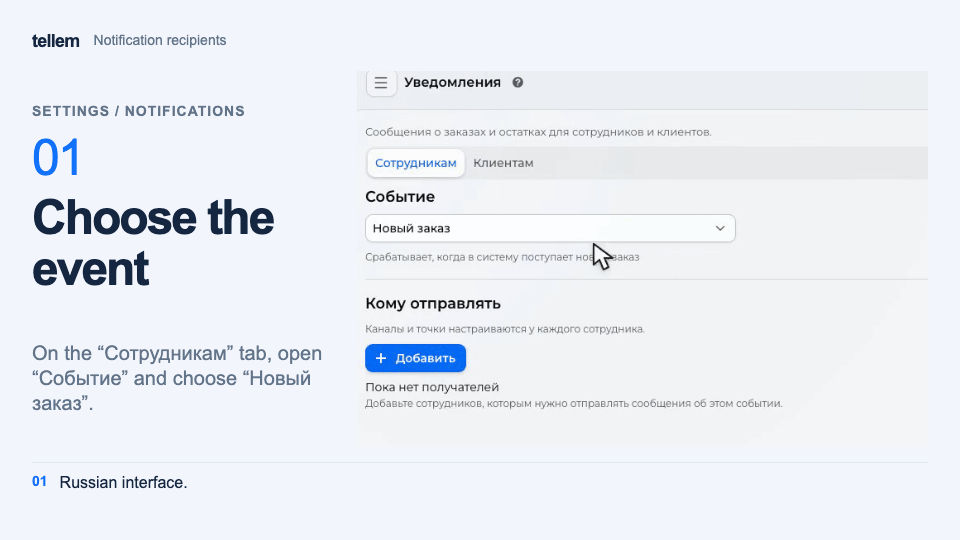

# Notifications { #notifications }

Configure staff messages about orders, stock, and store performance, and add text to customer notifications.

Open **Settings → Notifications**. On the **Staff** tab, choose an **Event**. On the **Customers** tab,
customize order status messages.

## For staff { #seller-notifications }

| Notification | When it is sent |
|---|---|
| Low stock | Stock changes and falls below **Stock below**; archived products are excluded |
| New order | An order is created as **New** or **Awaiting payment**, before payment |
| Order cancellation | A customer or staff member cancels an order |
| Overdue payment | An unpaid order is canceled or enters **Payment error** because the deadline expired or payment was declined |
| Unread orders | At the configured interval while **New** orders remain; **Repeat after** sets the interval in minutes |
| iiko errors | An order, status update, or stop list could not be transferred; the message includes [next steps](iiko-errors.md) |
| Daily digest | Every day at 09:00 CRM time, reporting yesterday |
| Weekly digest | Mondays at 09:00 CRM time, reporting the previous calendar week |
| Monthly digest | The first day at 09:00 CRM time, reporting the previous calendar month |

Set the payment deadline in the [payment method](payment-providers.md).

## Recipients { #seller-recipients }

1. Under **Recipients**, click **Add** and select the staff member's account from the customer list. A Telegram account is not required.
2. In **Send via**, choose one or more channels: **Telegram**, **VK**, **Email**. Contact details come from the customer card.
3. Choose the **Stores** whose notifications the staff member needs. Without a selected store, messages will not arrive. Low stock notifications do not have this field.

???+ example "Example: choosing notification channels"

    Example with demo data. The recording shows the Russian interface.

    <figure markdown="span">
    [{ width="960" height="540" loading=lazy }](../../media/crm/crm-staff-notifications.en.gif)
    </figure>

On a computer, the fields appear in the recipient's row. On a phone, tap **Settings** next to the recipient,
edit the fields in the dialog, and tap **Save**. **Cancel** and closing the dialog keep the previous settings.

To remove a recipient, click the trash icon in their row on a computer, or choose **Settings → Remove**
on a phone. Confirm removal. The staff member stops receiving messages only for the selected event;
their settings for other events stay unchanged.

Messages arrive through the selected available channels. For example, choose **Telegram** and **Email**
to receive them through both. Select all three to receive messages through all channels.

Choose **Automatic** to receive each message through one available channel, preferring Telegram,
then VK, then email. This option replaces individual channels; choosing an individual channel
turns off **Automatic**.

To pause messages, clear **Send via**. The recipient, their stores, and previous channel settings
stay saved. Choose the channels you need to resume delivery.

On a computer, changes in the row save immediately. Telegram requires a linked account and an enabled [bot integration](../../getting-started/bot-setup.md). Email requires mail delivery to be configured on the platform. If a channel is unavailable, a warning appears below **Send via**.

For VK, connect the [store community](vk.md). The staff member must link VK to their account and [allow community messages](../app/customer-notifications.md#vk). Messages arrive in their private conversation with the community. VK supports every event in the table above. Customer notification and mailing switches in the staff member's profile do not affect these messages.

With **Automatic**, the CRM chooses an available channel before sending. If delivery fails in the chosen channel, the CRM does not redirect the message to another.

**iiko errors** is available while at least one iiko connection is saved. It shares recipients with the connection wizard's **Notifications** step. Without recipients, nobody receives a message; if the affected venue is unknown, the selected staff with delivery enabled receive it.

## Manager digests { #store-digests }

Choose **Daily digest**, **Weekly digest**, or **Monthly digest** and add recipients.
Set the channels and stores for each digest separately. To pause one digest for
an employee, clear **Send via** in that recipient's settings.

The CRM sends digests at 09:00 CRM time: yesterday's report every day, the previous
calendar week on Mondays, and the previous calendar month on the first day.
**Next delivery** shows the date and time in your own time zone.

When you select several stores, the message contains a separate block for each.
Each block shows revenue from returning customers, total revenue, completed orders,
average order value, and new buyers. Changes compare the preceding day, week,
or month. The report period appears below the heading. A zero comparison base
has no percentage increase. Comparing shares requires at least 30 buyers.

A buyer is new when they make their first completed purchase across the network.
Cancellations, returns, and payment errors do not count towards revenue.
See [analytics](analytics.md) for metric definitions.

The **At risk** and **Need attention** counts come from the latest completed RFM
calculation. Changes compare these counts with
saved daily counts from the previous send date. Until that history is available,
you see current counts without a delta. In **Orders to review**, unprocessed orders
refer to the current moment; payment errors and cancellations refer to the report period.

**Analytics**, **Store RFM**, and **Orders** open the selected store's details in
the CRM after normal sign-in. The email chart shows total revenue and the contribution
from returning customers. Segment cards explain who is in each group and how you
can respond.

In Telegram, the digest has **Revenue**, **Customers and orders**, and **Needs attention**
sections, with tables of values and changes, segment explanations, and buttons
to open the CRM. VK provides a text version with values, changes, and links.

## For customers { #customer-status }

Customers receive **Order status change** messages through all [available channels they have enabled](../app/customer-notifications.md). Staff recipient settings do not affect them.

To add your own text to the system message:

1. Click **Create**, choose a **Status**, and enter a **Message**.
2. Review **Final message** and save. Each status can have one message; edit the existing one to change it.

The text is added to Telegram, VK, and email messages; push does not include it. The main text is sent without translations.

The `%name%` placeholder inserts an order system attribute's value, where `name` is the attribute name. [Custom integrations](integrations.md#пользовательские) can fill these attributes.
