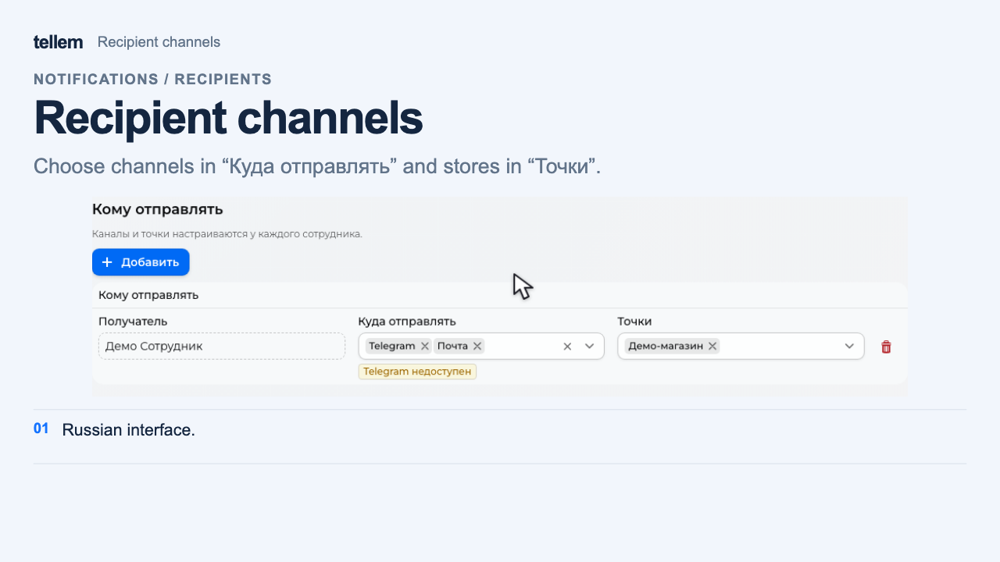

# iiko { #iiko }

Connect iiko to send orders to the checkout, select tables by QR code, and hide unavailable dishes.

Open **Integrations → iiko**.

## What you need in iiko { #iiko_1 }

- The restaurant's **API key**, an access key from iikoWeb for the required organizations.
- **App ID** and **App Secret**, the connection identifier and secret supplied by the Tellem team; the CRM field for App Secret is **Client secret**.
- A published external menu with prices, an active iikoFront terminal group, and order types for dine-in and pickup.
- A payment type for each online payment method; dining areas and tables if you need table QR codes.

!!! note "Who provides the credentials"
    Obtain the API key from iiko or your service partner. The Tellem team provides App ID and App Secret. Restaurants do not need to register an application on the iiko developer portal. Keep the credentials secret.

Ask your iiko partner to prepare an external menu in iikoWeb and confirm which price category to use. Select the menu and prices [in the connection settings](#terminals).

Before starting the wizard, [create stores](stores-and-delivery.md), enable **In establishment** and/or **Pickup**, and the required payments. For online payments, [connect a payment provider](payment-providers.md) first.

### What an iiko organization and terminal mean { #terms }

A **Tellem store** is a location where customers place orders; stores and chains appear under **Order destinations** in the wizard.

An **iiko organization** is the venue that owns the menu, payment types, and checkout settings. A **terminal** in the wizard means the iikoFront terminal group receiving orders. Confirm it with the iiko administrator: several physical checkouts can belong to one group.

## Connection { #_1 }

Click **Add integration**. Complete the four steps using **Next**, which validates the current step. **Back** returns to the previous step; **Save** on the last step saves the connection.

### 1. Connection { #credentials }

Enter a connection name, API key, App ID, and Client secret. For several restaurants, first confirm with your iiko partner that the key can access all required organizations.

Click **Next**. If the check fails, [check credentials and access](iiko-errors.md#connection). If a restaurant is missing, ask your iiko partner to check the key's access to its organization.

### 2. Venue connections { #terminals }

Under **Order destinations**, select the **iiko organization** and **iiko terminal** for each store or chain. The lists show names; you do not enter identifiers manually.

Under **Menus and prices**, select an **External menu** for each organization. If only one menu is available, it is selected automatically. Set a **Price category** if needed; leaving the field empty with the **Menu prices** placeholder uses the menu's own prices. All terminals of one organization within this connection share the same menu and price category. After saving, run a [full import](#import-products) to apply your selection to the catalog immediately.

| Operating setup | Mapping |
|---|---|
| One restaurant handles orders together | Store → restaurant organization → its group |
| Independent restaurants | A separate store for each → its organization and group |
| Two storefronts share a checkout | Both → one organization and group; their stop list is shared |
| Separate groups for dine-in and pickup | Separate Tellem stores with matching mappings; agree on the setup with the Tellem team |

!!! note "Mapping limits"
    Complete every row shown in the wizard. Each store has one organization and one group; orders are not distributed by checkout or fulfillment method. A second configuration does not add another terminal to the store.

### 3. Payments { #payments }

For each **online payment by link** method, select an **iiko payment method** for the corresponding store's organization.

Agree on two options with the person responsible for the checkout:

- **Payment processed outside iiko**: an external system has already collected payment.
- **Receipt issued outside iiko**: an external system also issues the fiscal receipt. Leave this off if iiko issues it.

With payment on receipt only, there is nothing to map: continue, and the cashier will collect payment. Any online method added later needs its own mapping.

### 4. Notifications { #notifications }

Add responsible staff, stores, and channels using the [notification recipient guide](crm-notifications.md#seller-recipients). These are the same settings as **Settings → Notifications → iiko errors**.

??? example "Recipient channels and stores"

    The shared recipient settings with demo data. The interface is in Russian.

    <figure markdown="span">
    [{ width="1280" height="720" loading=lazy }](../../media/iiko-setup/notifications.en.png)
    </figure>

You can save the connection without recipients, but nobody will receive error messages.

Click **Save**. CRM validates all steps and returns to any incomplete step.

### Check stop lists after saving { #setup-stop-list }

On the connection card, open **Actions → Stop lists**. Check each venue and its successful update time. **Not loaded yet** does not confirm an empty stop list. **Refresh now** queues a request; reopen stop lists to see its result.

**Hourly** mode means instant updates are not connected; see [how stop lists work](#-).

### Check before the first production order { #launch-check }

For each store → organization → terminal mapping, place an agreed test order and check:

- The receiving checkout, items, and total.
- Payment collected by the cashier on receipt, or the correct online payment type.
- Receipt issuance as agreed and the status returning to CRM.
- The current stop list and error recipients for the required store.

New stores or online methods are not connected automatically: open **Configure** and complete new rows. The card shows incomplete setup and stop list update problems. Deleting the configuration stops order transfer for its stores.

## Products { #_2 }

Every order item must be linked to iiko. One unlinked product blocks the entire order. You can [add products from the menu](#import-products) or [link your existing catalog](#link-existing-products).

For one item, open **Catalog → Products → Create → Add from iiko** and choose a dish. Review the copied name, price, and properties. For sizes and extras, run a [full menu import](#import-products). Orders use Tellem prices.

### Add or update a restaurant menu { #import-products }

After you save the connection, CRM updates the configured restaurants' menus once an hour and when iiko sends a menu change event. No open window is required. If events are not connected or are missed, hourly updates continue. To start an update manually, follow the steps below. View the results under **Integrations → iiko → Operation history**.

Open an import's **Details** in history to see created and changed menu items, automatic archiving and restoration, reasons, and links to products. Totals cover the entire menu. If there are too many diagnostic rows, the report shows how many were omitted; all created and changed menu items are retained.

!!! warning "Import enables product visibility"
    A full import, including an automatic update, makes new products with positive stock available to customers immediately. Repeating the import enables **Show in catalog** for previously hidden cards too; sale status under **Inventory** is preserved. Publish a menu in iiko when it is ready for sale. Manually edited names, descriptions, categories, and prices apply until the next full import.

1. In **Integrations → iiko**, find the restaurant on the connection card and click **Import products** in its row.
2. Choose **Entire menu**. The selected restaurant's import starts when the results window opens; there is no separate start action.
3. Review created and updated products, skipped items, errors, and warnings in the report. Find a product by name or article code and select its row to preview the photo, price, stock, extras, and sizes on the right. Use the button that opens the product card to check it in the catalog.

CRM adds missing products and categories, including dishes with sizes and supported extras. Categories with the same name are reused. Repeating the import updates names, descriptions, categories, prices, photos, sizes, extras, and availability without duplicates. Prices retain the fractional precision of the store currency. If iiko has no photos or the complete set cannot be downloaded, the existing CRM card keeps its photos.

Service items and dishes with invalid prices are skipped; check the report for the reason. If a dish's composition or extra rules cannot be transferred without changing their meaning, CRM does not apply the menu. Correct the reported cause in iiko and repeat the import.

Confirmed removal of a dish or size from the selected menu removes it from the restaurant's assortment. When no store retains it in its assortment, CRM archives the product. If the restaurant shares a warehouse with another store, CRM preserves the shared assortment and notes this in the report. Returning a dish or size with its original iiko link restores the same card and preserves order history. You cannot copy, delete, manually archive, or restore linked products or their groups in CRM. Change the menu in iiko and update it in CRM. Stop lists and zero stock do not archive products by themselves.

If a card is already used by another iiko connection or organization, the report shows a conflict: CRM does not overwrite shared data. If the previous assortment's source is unconfirmed, CRM does not remove that assortment. Check restaurant bindings before repeating the import.

Importing updates stock for products added from the menu separately for each terminal. A positive iiko limit becomes the CRM quantity without its fractional part, a stop gives zero, and no limit gives a nominal quantity. A nominal quantity does not confirm the physical number of portions. Size stock is tracked separately. The next successful full import — manual, hourly, or triggered by an iiko event — replaces the quantity, including any manually entered value; it does not add to the previous quantity. Previously linked products keep their manually managed stock.

If a stock warning appears, CRM saves product cards but creates no new inventory and preserves previous quantities for affected terminals. Repeat the import after the connection recovers or wait for the next hourly update. A photo error does not prevent saving the product.

!!! warning "An empty menu removes products from sale"
    A retrieval error or an unconfirmed incomplete response preserves the previous assortment. If iiko confirms again that the selected menu is empty, CRM removes previous items from the assortment under the rules above. Check a menu's contents before switching to it.

Closing the window stops the import started from that window while preserving completed work. An independent automatic update continues running. Running the import again adds the remainder without duplicates. The summary shows processed sizes and extras; after a stop or errors, review the unprocessed part.

### Link existing products { #link-existing-products }

In the restaurant row, click **Import products → By article code**. Linking starts when the results window opens.

Each product or variant's article code must exactly match its iiko code, including leading zeros, case, and spaces. The whole catalog is checked, including hidden and archived items. Dishes with sizes cannot be linked this way: use [menu import](#import-products).

Linking preserves product cards, prices, photos, stock, and history; no new products are created. Review linked and skipped items in the report. Correct empty or ambiguous codes and other reported causes, then repeat: existing links remain. If menu retrieval fails, the catalog is unchanged. To load extras for linked products, run a [full import](#import-products), allowing for its effect on prices and product visibility.

### Sizes and extras { #sizes-and-extras }

A full import creates dish sizes as product variants with their own prices and stock. Change the size selection in iiko: after the next full import, removed sizes become unavailable, while returning sizes keep their existing cards. You cannot create or delete these variants manually in CRM.

In the product card's **Modifiers** section, check extras, groups, required choices, limits, and free quantities. This section shows data from the last full import. Change it in iiko; CRM receives the changes during a [menu update](#import-products). Customers cannot order a linked dish before the first full import. Extras do not create separate catalog products.

Customers choose sizes and extras in the [product card and cart](../app/ui-and-pages.md#product-card). CRM orders show the selected size, extras, and their quantities. Promotions and birthday discounts reduce the dish or selected size price; extras are added without that discount.

## Orders { #_3 }

Mapped stores send orders without a separate custom integration. **In establishment** and **Pickup** are supported. In iikoFront, the number is **T** followed by the CRM number, with **Tellem** as the source; customer contacts and comments are included.

| Payment | When the order is sent | Further processing |
|---|---|---|
| On receipt | Immediately as **New**, without payment | The cashier collects payment and closes the order |
| Online by link | After **Paid** | Closes automatically; [payment mapping](#payments) is required |

An order closed in iiko becomes **Completed** in CRM; a canceled or deleted one becomes **Canceled**. CRM also checks statuses if an event is delayed; closing again does not award bonuses twice.

If iiko accepted an order but reported an error, its status becomes **Pending processing**, or **Getting ready** with one open warehouse. The reason appears in history and a notification. [Check the order at the checkout](iiko-errors.md#first-check) before resending; a transfer error does not mean the customer needs to pay again.

## Tables and QR codes { #qr- }

Saving the connection adds an optional **Table** field to mapped stores' **In establishment** methods, including those created later.

1. In **Catalog → Stores**, select the venue and click **Print QR code**.
2. Select a table on the plan or its card. **QR for the entire venue** restores the general code.
3. Print the code and scan it with a phone camera: it must open the correct venue and table.

CRM loads dining areas and tables from iiko; **Refresh tables** loads them again. If no tables appear, [check the terminal mapping and tables](iiko-errors.md#table). **Configure tables** adds the field to the selected store if it is missing.

Customer actions are described in [Checkout](../app/checkout.md).

## Stop lists { #- }

A stop list contains dishes whose sale is restricted by the checkout. At zero or lower quantity, CRM hides the dish in every store using that terminal, even if showing products with zero stock is enabled. A positive quantity limits purchases at checkout. A size-specific stop applies to that size; a general dish stop applies to all its sizes. Hiding individual extras through the stop list is not supported.

After a stop is removed, CRM availability settings apply again: manual disabling, warehouse stock, and reservations. A stop list update alone does not overwrite warehouse stock; products added from the menu receive stock updates during [import](#import-products).

Updates arrive through iiko events and hourly checks. If iiko already has another event recipient, Tellem preserves it and uses hourly checks. On failure, the last successful list stays in effect. For a manual check, open the [connection's stop lists](#setup-stop-list).

CRM checks the cart before creating an order and payment link. If a dish is unavailable, the customer must remove it or reduce its quantity; if the check fails, they must try checkout later.

## If something does not work { #_4 }

Open the [instructions for the error cause](iiko-errors.md). Under **Integrations → iiko → Operation history**, find the record by order and time. A successful operation does not confirm that the order reached the checkout: [check with the cashier](iiko-errors.md#first-check) before resending.
