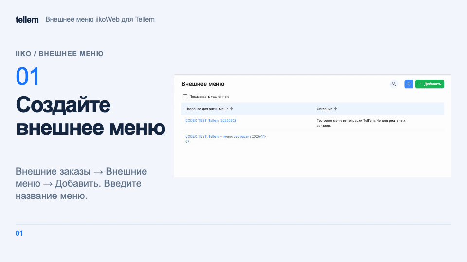
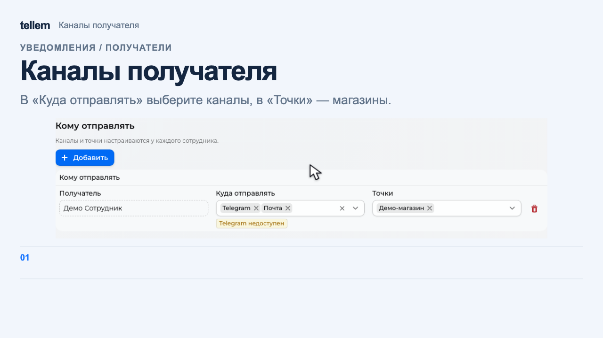
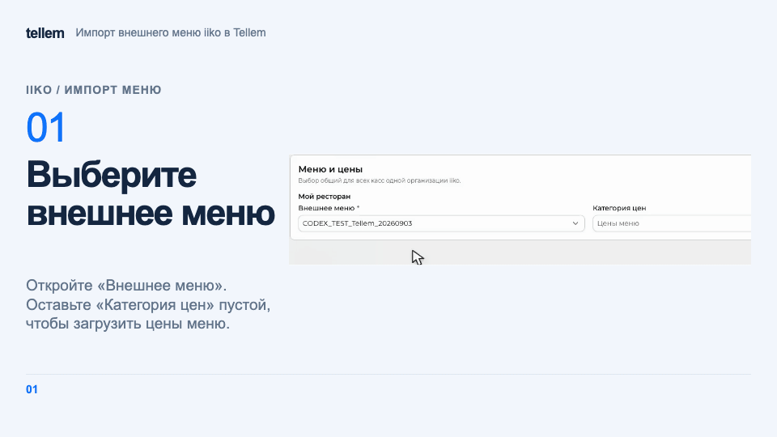

# iiko { #iiko }

Подключите iiko, чтобы передавать заказы в кассу, выбирать стол по QR-коду и скрывать недоступные блюда.

Откройте **Интеграции → iiko**.

## Что нужно в iiko { #iiko_1 }

- **API-ключ** — ключ доступа ресторана из iikoWeb, действующий для нужных организаций.
- **App ID** и **App Secret** — идентификатор и секрет подключения от команды Tellem; поле для App Secret в CRM называется **Client secret**.
- Опубликованное внешнее меню с ценами, активная терминальная группа iikoFront, типы заказа для зала и самовывоза.
- Тип оплаты для каждого способа онлайн-оплаты; залы и столы, если нужны QR-коды столов.

!!! note "Кто выдаёт реквизиты"
    API-ключ получите у iiko или своего обслуживающего партнёра. App ID и App Secret выдаёт команда Tellem. Регистрировать собственное приложение на портале разработчика iiko ресторану не нужно. Храните ключи в секрете.

До запуска мастера [создайте магазины](stores-and-delivery.md), включите **В заведении** и/или **Самовывоз** и нужную оплату. Для онлайн-оплаты сначала [подключите платёжный сервис](payment-providers.md).

### Подготовить внешнее меню в iikoWeb { #external-menu }

1. Откройте **Внешние заказы → Внешние меню**. Если подходящее меню уже есть, откройте его и переходите к проверке на шаге 3.
2. Нажмите **Добавить** и введите название, например «Меню для Tellem». В поле **Ресторан для загрузки цен** выберите нужное заведение, а в поле **Источник цен** — **Базовый прайс-лист**. Выберите **Сгенерировать меню** и нажмите **Сохранить**. iikoWeb соберёт меню из блюд и товаров, у которых указаны цена и место продажи.
3. Откройте **Список блюд**. Проверьте, что в меню есть нужные позиции, размеры и добавки. В iikoOffice откройте **Прейскурант → Прейскуранты товаров и услуг** и выберите дату. Сверьте цены блюд, размеров и платных добавок со столбцом **Цена** базового прейскуранта ресторана. Можно также сверить суммы при обычной продаже в iikoFront.
4. В **Настройки Cloud API → Интеграции** откройте интеграцию, чей API-ключ используете для Tellem. На вкладке **Основное** выберите подготовленное меню и установите **Источник цен → Внешнее меню**. На вкладке **Подключенные точки** проверьте, что выбран нужный ресторан. Сохраните изменения.

Если ресторан уже работает с Tellem, до смены источника сравните новое меню с действующим ассортиментом CRM и проверьте, какие цены изменятся. Позиции и размеры, которых нет в новом меню, могут уйти из ассортимента при [полной выгрузке](#import-products).

???+ example "Пример создания меню в iikoWeb"

    <figure markdown="span">
    [{ width="960" height="540" loading=lazy }](../../media/crm/iiko-external-menu-setup.gif)
    </figure>

### Что такое организация и терминал iiko { #terms }

**Магазин Tellem** — точка оформления заказа; в мастере магазины и сети показаны в блоке **Куда отправлять заказы**.

**Организация iiko** — заведение, к которому относятся меню, оплата и кассовые настройки. **Терминал** в мастере — терминальная группа iikoFront, принимающая заказы. Уточните её у администратора iiko: несколько физических касс могут входить в одну группу.

## Подключение { #_1 }

Для нового подключения нажмите **Добавить интеграцию**. Для смены меню в действующем подключении нажмите **Настроить** на его карточке. Проходите четыре шага кнопкой **Далее**; она проверяет заполненные данные. **Назад** возвращает на предыдущий шаг, **Сохранить** на последнем сохраняет подключение.

### 1. Подключение { #credentials }

Введите название подключения, API-ключ, App ID и Client secret. Если ресторанов несколько, заранее проверьте с партнёром iiko доступ ключа ко всем нужным организациям.

Нажмите **Далее**. Если проверка не проходит, [проверьте реквизиты и доступ](iiko-errors.md#connection). Если ресторана нет в списке, попросите партнёра iiko проверить доступ ключа к его организации.

### 2. Связь с заведениями { #terminals }

В блоке **Куда отправлять заказы** для каждого магазина или сети выберите **Организацию iiko** и **Кассу iiko**. Списки показывают названия; вводить идентификаторы вручную не нужно.

В блоке **Меню и цены** выберите **Внешнее меню** для каждой организации. Если доступно только одно меню, оно выбирается автоматически. Чтобы использовать цены внешнего меню, оставьте поле **Категория цен** пустым. В нём появится подсказка **Цены меню**. Все кассы одной организации в этом подключении используют одинаковые меню и категорию цен. Сохраните подключение и выполните [полную выгрузку](#import-products).

| Схема работы | Привязка |
|---|---|
| Один ресторан, общая обработка заказов | Магазин → организация ресторана → его группа |
| Независимые рестораны | Отдельный магазин для каждого → его организация и группа |
| Две витрины с общей кассой | Обе → одна организация и группа; стоп-лист общий |
| Раздельные группы для зала и самовывоза | Отдельные магазины Tellem с соответствующими привязками; согласуйте схему с командой Tellem |

!!! note "Ограничения привязки"
    Заполните все строки, показанные мастером. У магазина одна организация и одна группа; распределения по кассам или способу получения нет. Вторая конфигурация не добавляет магазину второй терминал.

### 3. Оплата { #payments }

Для каждого способа **онлайн-оплаты по ссылке** выберите **Способ оплаты в iiko** для организации соответствующего магазина.

Согласуйте с ответственным за кассу два признака:

- **Оплата принята вне iiko**: платёж уже принят внешней системой.
- **Чек сформирован вне iiko**: внешняя система также выдаёт кассовый чек. Если чек выдаёт iiko, оставьте признак выключенным.

При оплате только при получении сопоставлять нечего: переходите дальше, оплату примет кассир. Новый онлайн-способ позднее потребует отдельного сопоставления.

### 4. Уведомления { #notifications }

Добавьте ответственных сотрудников, выберите магазины и каналы по [инструкции для получателей уведомлений](crm-notifications.md#seller-recipients). Это те же настройки, что в **Настройки → Уведомления → Ошибки iiko**.

??? example "Каналы и точки получателя"

    Общий блок настройки получателя с демонстрационными данными.

    <figure markdown="span">
    [{ width="1280" height="720" loading=lazy }](../../media/iiko-setup/notifications.png)
    </figure>

Можно сохранить подключение без получателей, но тогда никто не получит сообщение об ошибке.

Нажмите **Сохранить**. CRM проверит все шаги и вернёт к незаполненному.

### Проверить стоп-листы после сохранения { #setup-stop-list }

В карточке подключения откройте **Действия → Стоп-листы**. Проверьте каждое заведение и время успешного обновления. **Ещё не загружен** не подтверждает пустой стоп-лист. **Обновить сейчас** ставит запрос в очередь; повторно откройте стоп-листы, чтобы увидеть результат.

Режим **раз в час** означает, что мгновенные обновления не подключены; см. [как действует стоп-лист](#-).

### Проверка перед первым рабочим заказом { #launch-check }

Для каждой привязки магазин → организация → терминал оформите согласованный контрольный заказ и проверьте:

- нужную кассу, состав и сумму заказа;
- оплату кассиром при получении либо правильный тип онлайн-платежа;
- выдачу чека по согласованной схеме и возврат статуса в CRM;
- актуальный стоп-лист и получателей ошибок нужного магазина.

Новый магазин или онлайн-способ сами не подключатся: откройте **Настроить** и заполните новые строки. Карточка показывает незавершённую настройку и проблемы обновления стоп-листа. Удаление конфигурации прекращает передачу заказов её магазинов.

## Товары { #_2 }

Для передачи заказа каждая позиция должна быть связана с iiko. Один несвязанный товар блокирует весь заказ. Можно [добавить товары из меню](#import-products) или [связать существующий каталог](#link-existing-products).

Для отдельной позиции откройте **Каталог → Товары → Создать → Добавить из iiko** и выберите блюдо. Проверьте скопированные название, цену и свойства. Для размеров и добавок выполните [полную выгрузку меню](#import-products). Заказы передаются по ценам Tellem.

### Добавить или обновить меню ресторана { #import-products }

После сохранения подключения CRM обновляет меню настроенных ресторанов раз в час и по событиям изменения меню от iiko. Открытое окно не требуется. Если события не подключены или пропущены, работает часовое обновление. Чтобы запустить обновление вручную, выполните шаги ниже. Результаты доступны в **Интеграции → iiko → История операций**.

Откройте **Подробности** выгрузки в истории: отчёт показывает созданные и изменённые позиции меню, автоматический архив и восстановление, причины и ссылки на товары. Итоговые числа учитывают всё меню. Если диагностических строк слишком много, отчёт указывает, сколько из них не сохранено; созданные и изменённые позиции меню сохраняются полностью.

!!! warning "Выгрузка включает показ товаров"
    При полной выгрузке, в том числе автоматической, новые товары с положительным остатком доступны покупателям сразу. Повторная выгрузка включает **Показывать в каталоге** и у ранее скрытых карточек; статус продажи в разделе **Наличие** сохраняется. Публикуйте в iiko меню, готовое к продаже. Изменённые вручную название, описание, категория и цена действуют до следующей полной выгрузки.

1. В **Интеграции → iiko** найдите ресторан в карточке подключения и нажмите **Выгрузить товары** в его строке.
2. В блоке **Всё меню** нажмите **Добавить товары из iiko**. Выгрузка начнётся при открытии окна результатов.
3. Проверьте созданные и обновлённые товары, пропуски, ошибки и предупреждения в отчёте. Найдите товар по названию или артикулу и выберите строку для просмотра фотографии, цены, остатка, добавок и размеров. Сверьте с внешним меню цену обычной позиции, цены размеров выбранного блюда и цену платной добавки, если они есть в меню. Кнопка открытия карточки позволяет проверить товар в каталоге.

???+ example "Пример: выбор меню и полная выгрузка"

    <figure markdown="span">
    [{ width="960" height="540" loading=lazy }](../../media/crm/iiko-menu-import.gif)
    </figure>

CRM добавляет недостающие товары и категории, включая блюда с размерами и поддерживаемыми добавками. Категории с одинаковым названием используются повторно. Повторная выгрузка обновляет названия, описания, категории, цены, фотографии, размеры, добавки и наличие без дубликатов. Дробная часть цены сохраняется с точностью валюты магазина. Если в iiko нет фотографий или не удалось загрузить весь набор, фотографии существующей карточки CRM сохраняются.

Служебные позиции и блюда с некорректной ценой пропускаются; причину смотрите в отчёте. Если состав блюда или правила добавок нельзя перенести без изменения смысла, CRM не применяет меню. Исправьте указанную причину в iiko и повторите выгрузку.

Подтверждённое удаление блюда или размера из выбранного меню убирает его из ассортимента ресторана. Когда ассортимент исчезает во всех магазинах, CRM отправляет товар в архив. Если ресторан использует общий склад с другим магазином, CRM сохраняет общий ассортимент и указывает это в отчёте. Возврат блюда или размера с прежней связью iiko восстанавливает ту же карточку; история заказов сохраняется. Копировать, удалять, вручную архивировать или восстанавливать связанные товары и их группы в CRM нельзя. Изменяйте меню в iiko и обновляйте его в CRM. Стоп-лист и нулевой остаток сами по себе не отправляют товар в архив.

Если карточка уже используется другим подключением или организацией iiko, отчёт показывает конфликт: CRM не перезаписывает общие данные. Если источник прежнего ассортимента не подтверждён, CRM не удаляет этот ассортимент. Проверьте привязки ресторанов перед повторным импортом.

Выгрузка обновляет остатки добавленных из меню товаров отдельно для каждого терминала. Положительный лимит iiko становится количеством CRM без дробной части, стоп даёт ноль, а отсутствие лимита даёт условный запас. Условный запас не подтверждает физическое количество порций. Остатки размеров учитываются отдельно. Следующая успешная полная выгрузка — ручная, часовая или по событию iiko — заменяет количество, включая введённое вручную; к прежнему количеству оно не прибавляется. Ручные остатки ранее связанных товаров сохраняются.

При предупреждении об остатках CRM сохраняет карточки, но для терминалов с ошибкой не создаёт новое наличие и не меняет прежнее количество. После восстановления связи повторите выгрузку или дождитесь следующего часового обновления. Ошибка фотографии не отменяет сохранение товара.

!!! warning "Пустое меню снимает товары с продажи"
    Ошибка загрузки или неподтверждённый неполный ответ сохраняет прежний ассортимент. Если iiko повторно подтверждает, что выбранное меню пустое, CRM убирает прежние позиции из ассортимента по правилам выше. Перед сменой меню проверьте его состав.

Закрытие окна останавливает запущенную из него выгрузку, сохраняя завершённую работу. Независимое автоматическое обновление продолжает работать. Повторный запуск добавит оставшееся без дубликатов. Сводка показывает обработанные размеры и добавки; при остановке или ошибках проверьте необработанную часть.

### Привязка уже созданных товаров { #link-existing-products }

В строке ресторана нажмите **Выгрузить товары → По артикулам**. Привязка начнётся при открытии окна результатов.

Артикул товара или каждого варианта должен точно совпадать с кодом iiko, включая нули в начале, регистр и пробелы. Проверяется весь каталог, включая скрытые и архивные позиции. Размерные блюда этим способом не связываются: используйте [добавление меню](#import-products).

Привязка сохраняет карточки, цены, фотографии, остатки и историю; новые товары не создаются. В отчёте проверьте связанные и пропущенные позиции. Исправьте пустые или неоднозначные артикулы и другие указанные причины, затем повторите действие: существующие связи сохраняются. При ошибке получения меню каталог не меняется. Чтобы загрузить добавки для связанных товаров, выполните [полную выгрузку](#import-products), учитывая её влияние на цены и показ карточек.

### Размеры и добавки { #sizes-and-extras }

Полная выгрузка создаёт размеры блюда как варианты товара с собственными ценами и наличием. Изменяйте набор размеров в iiko: после следующей полной выгрузки исчезнувшие размеры станут недоступны, а вернувшиеся сохранят прежние карточки. Создавать или удалять такие варианты вручную в CRM нельзя.

В карточке товара в разделе **Модификаторы** проверьте добавки, группы, обязательный выбор, допустимое и бесплатное количество. Здесь показаны данные последней полной выгрузки. Изменяйте их в iiko; CRM получит изменения при [обновлении меню](#import-products). До первой полной выгрузки покупатель не сможет оформить связанное блюдо. Добавки не создают отдельные товары каталога.

Покупатель выбирает размер и добавки в [карточке товара и корзине](../app/ui-and-pages.md#product-card). В заказе CRM видны выбранные размер, добавки и их количество. Акции и скидка на день рождения уменьшают цену блюда или выбранного размера; стоимость добавок прибавляется без этой скидки.

## Заказы { #_3 }

Передача включается для привязанных магазинов без отдельной пользовательской интеграции. Поддерживаются **В заведении** и **Самовывоз**. В iikoFront номер состоит из **T** и номера CRM, источник — **Tellem**; передаются контакты покупателя и комментарий.

| Оплата | Когда заказ передаётся | Дальнейшая обработка |
|---|---|---|
| При получении | Сразу в статусе **Новый**, без платежа | Кассир принимает оплату и закрывает заказ |
| Онлайн по ссылке | После статуса **Оплачено** | Закрывается автоматически; нужно [сопоставление оплаты](#payments) |

Закрытый в iiko заказ получает **Завершён** в CRM, отменённый или удалённый — **Отменён**. При задержке события CRM также проверяет статус; повторное закрытие не начисляет бонусы второй раз.

Если iiko принял заказ, но сообщил об ошибке, статус станет **Ожидает обработки**, а при одном открытом складе — **Собирается**. Причина появляется в истории и уведомлении. [Проверьте заказ на кассе](iiko-errors.md#first-check) до повторной отправки; ошибка передачи не означает, что покупателю нужно платить снова.

## Столы и QR-коды { #qr- }

После сохранения подключения CRM добавляет необязательное поле **Стол** к способам **В заведении** привязанных магазинов, включая созданные позднее.

1. В **Каталог → Магазины** выберите заведение и нажмите **Распечатать QR-код**.
2. Выберите стол на плане или его карточку. **QR для всего заведения** возвращает общий код.
3. Распечатайте код и проверьте его камерой телефона: должны открыться нужные заведение и стол.

CRM загружает залы и столы из iiko; **Обновить столы** повторяет загрузку. Если столов нет, [проверьте привязку терминала и столы](iiko-errors.md#table). **Настроить столы** добавляет поле выбранному магазину, если его нет.

Действия покупателя описаны в [оформлении заказа](../app/checkout.md).

## Стоп-листы { #- }

Стоп-лист — список блюд, продажу которых ограничила касса. При количестве ноль или меньше CRM скрывает блюдо во всех магазинах этого терминала, даже если показ товаров с нулевым остатком включён. Положительное количество ограничивает покупку при оформлении. Стоп отдельного размера действует на этот размер, общий стоп блюда — на все его размеры. Отдельное скрытие добавок по стоп-листу не поддерживается.

После снятия стопа снова действуют настройки наличия CRM: ручное отключение, склад и резервы. Обновление стоп-листа само по себе не переписывает складские остатки; для добавленных из меню товаров они обновляются при [выгрузке](#import-products).

Обновления приходят по событиям iiko и раз в час. Если в iiko уже настроен другой получатель событий, Tellem его не заменяет и использует часовой опрос. При ошибке остаётся последний успешный список. Для ручной проверки откройте [стоп-листы подключения](#setup-stop-list).

До создания заказа и платёжной ссылки CRM проверяет корзину. При нехватке блюда покупателю нужно удалить его или уменьшить количество; при ошибке проверки — повторить оформление позже.

## Если не работает { #_4 }

Откройте [действия по причине ошибки](iiko-errors.md). В **Интеграции → iiko → История операций** можно найти запись по заказу и времени. Успешная операция не подтверждает появление заказа на кассе: перед повторной отправкой [сверьте его с кассиром](iiko-errors.md#first-check).
