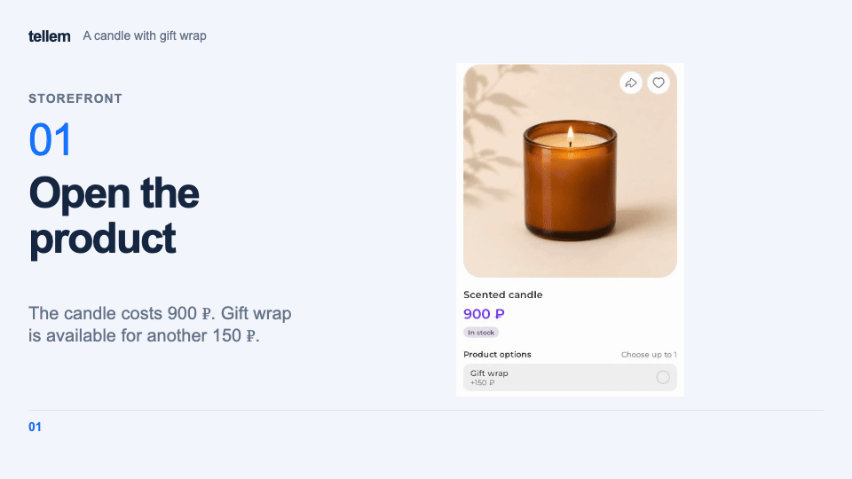

# Add a modifier to a product { #product-modifiers }

Use a modifier to offer customers gift wrap with a candle or oat milk with coffee. In this example, the candle costs 900 RUB. Customers can add gift wrap for 150 RUB.

You can create your own modifiers in CRM if your store operates without iiko. If you connect iiko later, customers will no longer see the options you created manually. You can view imported options in CRM and edit them in the [iiko menu](iiko.md#sizes-and-extras).

## Add gift wrap in CRM { #add-option }

1. Open **Catalog → Products**. If you see a flat list of products, switch to **Group variative products**. Select your product (“Scented candle” in this example) and click **Edit**.
2. Open the **Modifiers** tab and click **Create modifier**. On a narrow screen, look under **Actions**.
3. Enter “Gift wrap” in **Name** and `150` in **Price**. You can also add a photo of the wrapping. Keep **Available for selection** checked.
4. For this example, leave **Selection rules** at their defaults. Customers can order the candle on its own or add one gift wrap.
5. Click **Save** in the modifier window. When “Gift wrap” appears in the list, click **Save** again in the product card.

???+ example "Create and save the gift wrap option"

    <figure markdown="span">
    [{ width="960" height="540" loading=lazy }](../../media/crm/local-product-modifier.en.gif)
    </figure>

To change the price or photo, select the row on the same tab and click **Open**. If a product has several variants, the modifier applies to all of them.

## Check the result in the customer app { #storefront }

Open the candle in the app. It starts at 900 RUB. Under **Product options**, select **Gift wrap**. The price changes to 1,050 RUB. Tap **Buy** to open the cart. Gift wrap appears under the candle’s name, and the price includes the extra charge.

??? example "Choose gift wrap in the app"

    <figure markdown="span">
    [{ width="960" height="540" loading=lazy }](../../media/app/local-product-modifier.en.gif)
    </figure>
