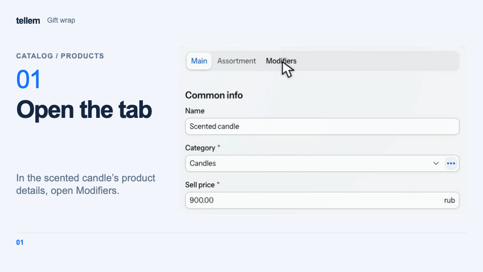
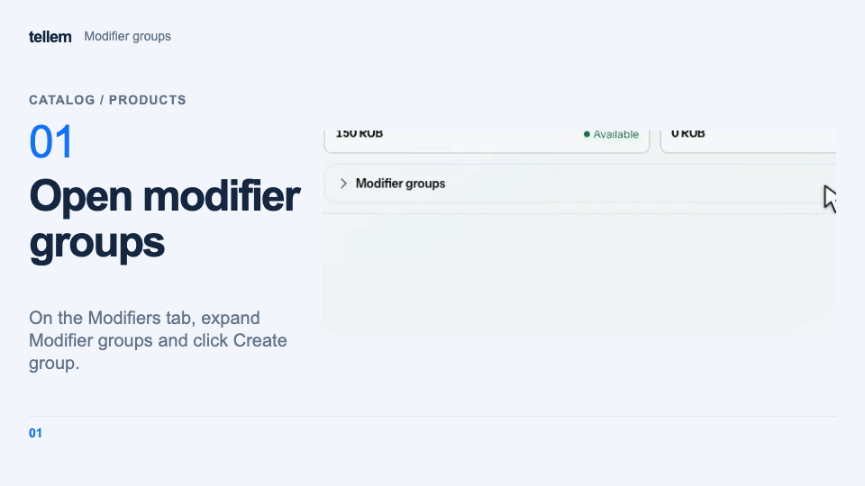

# Add a modifier to a product { #product-modifiers }

A modifier gives customers a choice when ordering a product. For example, a customer can add gift wrap to a candle for 150 RUB. An electronics store could offer a screen protector with a phone, and a café could offer oat milk for coffee. The examples in CRM reflect the business type you chose during setup.

You can create your own modifiers in CRM if your store operates without iiko. If you connect iiko later, customers will no longer see the options you created manually. For imported options, see [Sizes and extras](iiko.md#sizes-and-extras).

## Add gift wrap in CRM { #add-option }

1. Open **Catalog → Products**. If you see a flat list of products, switch to **Group variative products**. Select your product (“Scented candle” in this example) and click **Edit**.
2. Open the **Modifiers** tab and click **Create modifier**.
3. Enter “Gift wrap” in **Storefront name** and `150` in **Extra price per unit**. For a free option, enter `0`. To add a picture, click **Upload photo**. Keep **Available for selection** checked.
4. Leave **Selection rules** at their defaults. Customers can order the candle on its own or add one gift wrap.
5. Click **Save** in the modifier window. A “Gift wrap” card appears on the tab. Click **Save** at the bottom of the product editor. This button saves changes across all of the product’s tabs.

???+ example "Create and save the gift wrap option"

    <figure markdown="span">
    [{ width="960" height="540" loading=lazy }](../../media/crm/local-product-modifier.en.gif)
    </figure>

To change the price or replace the photo, click the modifier’s name on its card. Each card shows the extra price, availability, and group if you assigned one. If a product has several variants, the modifier applies to all of them.

## Group options together { #modifier-groups }

Use a group when customers can choose between options. For example, a “Packaging” group can offer a kraft paper bag and a gift box. The single gift wrap option above works without a group.

1. On the **Modifiers** tab, expand **Modifier groups** and click **Create group**. On a narrow screen, open **Actions** within the groups section.
2. Enter “Packaging” as the group name. To let customers skip packaging or choose one, keep the minimum at `0` and the maximum at `1`. Click **Save**.
3. Open or create the “Kraft paper bag” modifier. Select “Packaging” in **Modifier group** and save. Add “Gift box” to the same group. Keep the minimum at `0` for each option so neither one is individually required.
4. Check the group name on each card and click **Save** at the bottom of the product editor.

??? example "Create a group and assign an option to it"

    <figure markdown="span">
    [{ width="960" height="540" loading=lazy }](../../media/crm/product-modifier-group.en.gif)
    </figure>

## Check the result in the customer app { #storefront }

Open the candle in the app. It starts at 900 RUB. Under **Product options**, select **Gift wrap**. The price changes to 1,050 RUB. Tap **Buy** to open the cart. Gift wrap appears under the candle’s name, and the price includes the extra charge.

??? example "Choose gift wrap in the app"

    <figure markdown="span">
    [{ width="960" height="540" loading=lazy }](../../media/app/local-product-modifier.en.gif)
    </figure>
