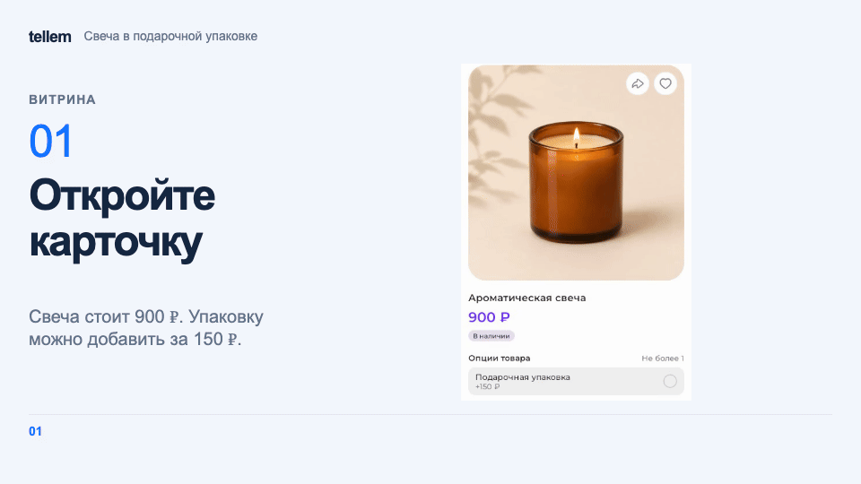

# Как добавить модификатор к товару { #product-modifiers }

Модификатор даёт покупателю выбор при заказе товара. Например, к свече можно добавить подарочную упаковку за 150 ₽. Для магазина электроники таким дополнением может быть защитное стекло к телефону, для кофейни — овсяное молоко к кофе. Подсказки в CRM учитывают тип бизнеса, который вы выбрали при первоначальной настройке.

Свои модификаторы можно создавать в CRM, если магазин работает без iiko. Если подключить iiko позже, покупатели перестанут видеть опции, созданные вручную. О работе с импортированными добавками читайте в разделе [«Размеры и добавки»](iiko.md#sizes-and-extras).

## Добавьте подарочную упаковку в CRM { #add-option }

1. Откройте **Каталог → Товары**. Если товары показаны плоским списком, включите **Группировать вариативные товары**. Выберите товар (в примере это «Ароматическая свеча») и нажмите **Изменить**.
2. Перейдите на вкладку **Модификаторы** и нажмите **Создать модификатор**.
3. В поле **Название на витрине** введите «Подарочная упаковка». В поле **Доплата за единицу** укажите `150`. Для бесплатной опции укажите `0`. При желании нажмите **Загрузить фото**. Оставьте флажок **Доступен для выбора** включённым.
4. Оставьте **Правила выбора** без изменений. Покупатель сможет заказать свечу без упаковки или добавить одну упаковку.
5. Нажмите **Сохранить** в окне модификатора. На вкладке появится карточка «Подарочная упаковка». Нажмите **Сохранить** внизу редактора товара. Эта кнопка сохраняет изменения на всех вкладках товара.

???+ example "Как создать и сохранить упаковку"

    <figure markdown="span">
    [{ width="960" height="540" loading=lazy }](../../media/crm/local-product-modifier.gif)
    </figure>

Чтобы изменить цену или заменить фото, нажмите на название модификатора в его карточке. На карточке также видны доплата, доступность и группа, если вы её назначили. У товара с несколькими вариантами модификатор действует для всех вариантов.

## Объедините варианты в группу { #modifier-groups }

Группа нужна, когда покупателю предстоит выбрать из нескольких вариантов. Например, в группе «Упаковка» можно предложить крафтовый пакет и подарочную коробку. Для одной подарочной упаковки из примера выше группу создавать не нужно.

1. На вкладке **Модификаторы** раскройте **Группы модификаторов** и нажмите **Создать группу**. На узком экране эта команда находится в меню **Действия** внутри раздела групп.
2. Введите название «Упаковка». Чтобы покупатель мог пропустить выбор или взять одну упаковку, оставьте минимум `0` и максимум `1`. Нажмите **Сохранить**.
3. Откройте или создайте модификатор «Крафтовый пакет». В поле **Группа модификаторов** выберите «Упаковка» и сохраните. Точно так же добавьте в группу «Подарочную коробку». Для обеих опций оставьте минимум `0`, чтобы ни одна не была обязательной сама по себе.
4. Проверьте название группы на карточках и нажмите **Сохранить** внизу редактора товара.

??? example "Как создать группу и привязать к ней вариант"

    <figure markdown="span">
    [{ width="960" height="540" loading=lazy }](../../media/crm/product-modifier-group.gif)
    </figure>

## Проверьте результат в приложении покупателя { #storefront }

Откройте свечу в приложении. Сначала она стоит 900 ₽. В разделе **Опции товара** выберите **Подарочная упаковка**. Цена станет 1 050 ₽. Нажмите **Купить**, чтобы открыть корзину. Под названием свечи вы увидите упаковку, а в цене уже будет учтена доплата.

??? example "Как покупатель выбирает упаковку"

    <figure markdown="span">
    [{ width="960" height="540" loading=lazy }](../../media/app/local-product-modifier.gif)
    </figure>
