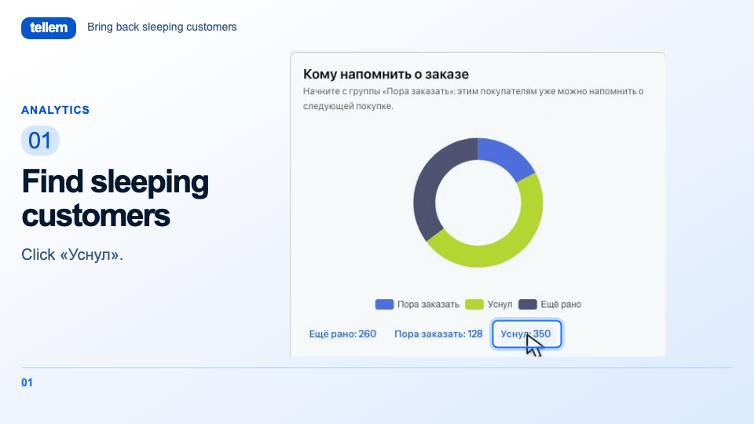

# Bring back dormant buyers { #asleep }

## 1. Check who has gone a long time without buying { #diagnose }

1. Under **Analytics → Repeat orders**, select a location. In **“Who to remind”**, click the count next to **“Asleep”** to open the list of customers who have gone a long time without buying.
2. Open **“Profile”** in a few [customer records](../clients.md#customer-record). Check how many days have passed since their last order and which categories they prefer.

???+ example "Who is marked Asleep"

    Demo data. The recording shows the Russian interface.

    <figure markdown="span">
    [{ width="864" height="486" loading=lazy }](../../../media/crm/repeat-asleep-audience.en.gif)
    </figure>

## 2. Prepare an offer and send the campaign { #launch }

1. Under **Analytics → Segments → Create segment**, select the same location. Set **“Order count: from”** to **2**. In **“Repeat purchase status”**, select **“Asleep”**. Save the segment as “Dormant repeat buyers”.
2. Pick a familiar item. This example uses coffee beans. [Create the promo code](../promo-codes.md#promo-codes) `DEMO10` for 10% off the coffee. To contact only customers who prefer coffee, add **“Favourite category”** and check how many customers remain.
3. [Create a mailing](index.md#prepare-campaign) for that segment from **“Saved”**. Set the goal to **“Reactivate inactive customers”** and the window to **14 days**. Include the product, code, and end date in the message.

**Example message**

> It's been a while! Get 10% off whole coffee beans with code DEMO10 through [end date].

## 3. Review purchases over 14 days { #review }

After the window closes, select the sent campaign under **Marketing → Mailings** and open **“Result”**. The table shows an example final report.

| Metric | Value |
| --- | ---: |
| Audience | 125 |
| Made a purchase | 20 |
| Share of buyers | 16% |
| Orders | 24 |
| Revenue | ₽24,000 |
| Average order value | ₽1,000 |
| Revenue per participant | ₽192 |

???+ example "Result of a win-back campaign"

    Demo data. The recording shows the Russian interface.

    <figure markdown="span">
    [{ width="864" height="486" loading=lazy }](../../../media/crm/repeat-asleep-result.en.gif)
    </figure>

Compare the share of buyers and revenue per participant with the [final result of a comparable campaign](index.md#read-result). If many customers **“Visited the store”** and few bought, check the promo code expiry date, stock, and offer conditions in the app.
