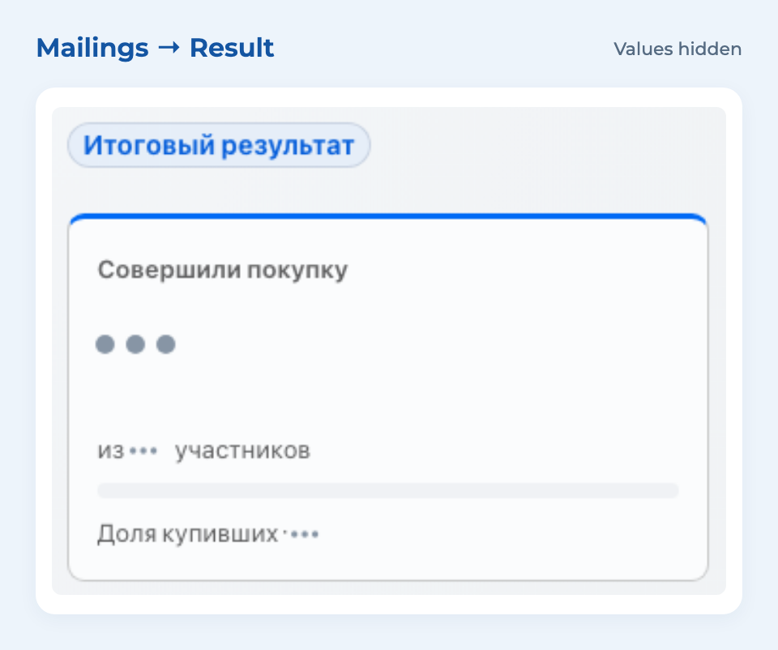

# Bring back dormant buyers { #asleep }

## 1. Find customers who stopped ordering { #diagnose }

Open **Analytics → Repeat orders** and select a location. Under **“Who to remind”**, click the count next to **“Asleep”** to open the customer list.

<figure markdown="span">
[{ width="504" height="475" loading=lazy }](../../../media/crm/repeat-analytics-customer-groups.en.png){ .glightbox }
<figcaption>Open «Уснул» (Asleep) in analytics. Choose the same status when you build the segment.</figcaption>
</figure>

Open **“Profile”** in a few [customer records](../clients.md#customer-record). Check when they last ordered and which products they like. Use that to choose an offer that gives them a reason to return.

???+ example "Watch how to open the list and check the last order"

    <figure markdown="span">
    [{ width="864" height="486" loading=lazy }](../../../media/crm/repeat-asleep-audience.en.gif)
    </figure>

## 2. Remind them of a familiar item { #launch }

1. Under **Analytics → Segments → Create segment**, select the same location and the **“Asleep”** repeat purchase status. To reach former regulars, set **“Order count: from”** to two. Save the segment.
2. Open **Marketing → Mailings → Create** and choose **“Reactivate inactive customers”** as the goal. Under **“Segments”**, select your group from **“Saved”**.
3. Add a link to the item. If you offer a discount, include the expiry date of the [promo code](../promo-codes.md#promo-codes). Check who can receive the message, then [schedule the mailing](index.md#prepare-campaign).

## 3. Check whether buyers came back { #review }

Under **Marketing → Mailings**, select the campaign and click **“Result”**. Once you see **“Final result”**, check **“Share of buyers”**. Compare it with a [previous mailing](index.md#read-result) for dormant buyers over the same observation window.

<figure markdown="span">
[{ width="504" height="421" loading=lazy }](../../../media/crm/repeat-report-buyer-share.en.png){ .glightbox }
<figcaption>Each customer counts once in the share of buyers, even if they placed several orders.</figcaption>
</figure>

- **A higher share bought.** Try the offer with the next group of dormant buyers.
- **The share stayed flat or fell.** Check **“Visited the store”**. If people visited but few bought, check whether the item was in stock and the discount worked.

???+ example "Watch where to find returning buyers in the report"

    <figure markdown="span">
    [{ width="864" height="486" loading=lazy }](../../../media/crm/repeat-asleep-result.en.gif)
    </figure>
