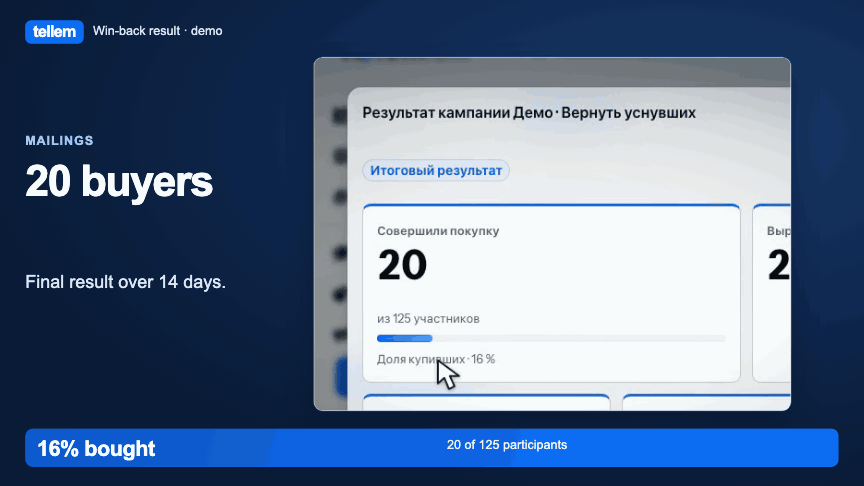

# Bring back dormant buyers { #asleep }

Start with customers who bought several times and are past the usual interval for their location. Use their order history to find a familiar category and give them a reason to return.

## 1. Check who has gone a long time without buying { #diagnose }

1. Under **Analytics → Repeat orders**, select a location and open **“Who to remind”**. Find the count beside **“Asleep”** and click it to open the customer list.
2. Open a few [customer records](../clients.md#customer-record). Under **“Profile”**, compare days since the last order with the usual interval for the location. If the profile lists a favorite category, start there. To check individual items, take numbers from the **“Orders”** tab and [open those orders](../orders.md#check-the-order) in the **Orders** section.

???+ example "Who is marked Asleep"

    Demo data. The recording shows the Russian interface.

    <figure markdown="span">
    [{ width="960" height="540" loading=lazy }](../../../media/crm/repeat-asleep-audience.en.gif)
    </figure>

## 2. Prepare an offer and send the campaign { #launch }

1. Under **Analytics → Segments → Create segment**, select the same location. Set **“Order count: from”** to **2**. In **“Repeat purchase status”**, select **“Asleep”**. Save the segment as “Dormant repeat buyers”.
2. Choose an offer based on order history. In this example, customers bought coffee beans. [Create the promo code](../promo-codes.md#promo-codes) `DEMO10` for 10% off that item. Check the dates, eligible products, and usage limits. To target buyers who prefer a specific category, add **“Favourite category”** to the segment and review the updated count.
3. Under **Marketing → Mailings → Create**, select the same location, the segment from **“Saved”**, and **“Reactivate inactive customers”**. Include the products, the code, and the offer end date in the message. Check [recipients and advertising consent](../mass-mailings.md#recipients) and [schedule the campaign](index.md#prepare-campaign) with a **14-day** window.

**Example message**

> It's been a while! Get 10% off whole coffee beans with code DEMO10 through [end date].

## 3. Review purchases over 14 days { #review }

After the window closes, select the sent campaign under **Marketing → Mailings** and open **“Result”**. The table shows an example final report.

| Metric | Value |
| --- | ---: |
| Audience | 125 |
| Made a purchase | 20 |
| Share of buyers | 16% |
| Orders | 24 |
| Revenue | ₽24,000 |
| Average order value | ₽1,000 |
| Revenue per participant | ₽192 |

???+ example "Result of a win-back campaign"

    Demo data. The recording shows the Russian interface.

    <figure markdown="span">
    [{ width="960" height="540" loading=lazy }](../../../media/crm/repeat-asleep-result.en.gif)
    </figure>

Compare the share of buyers and revenue per participant with the [final result of a comparable campaign](index.md#read-result). If many customers **“Visited the store”** and few bought, check the promo code expiry date, stock, and offer conditions in the app.
