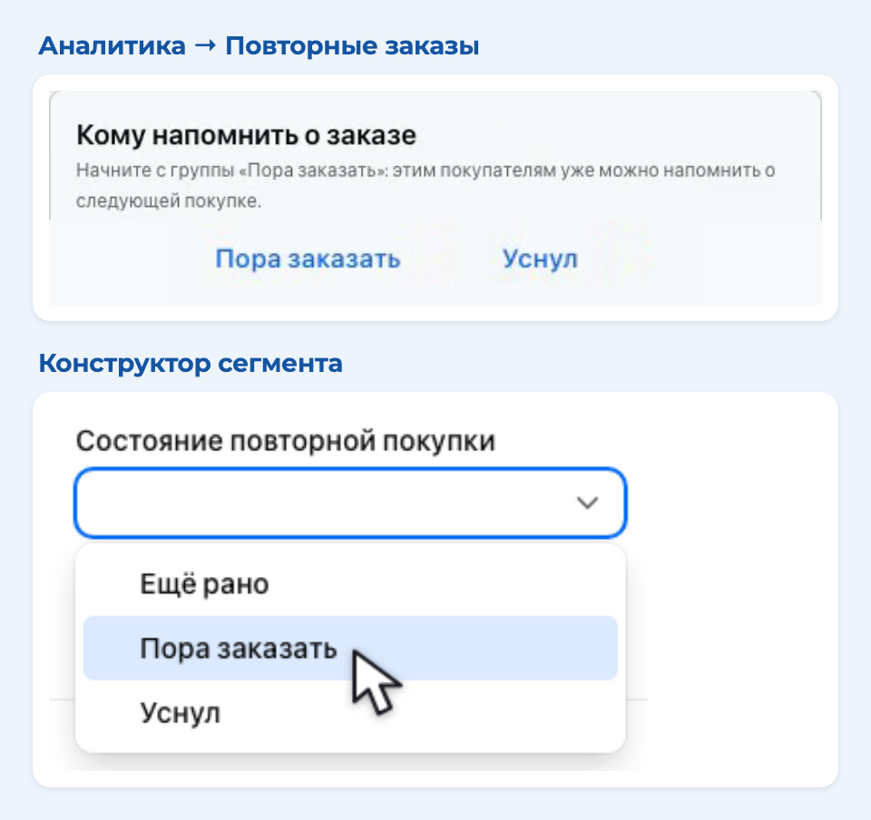
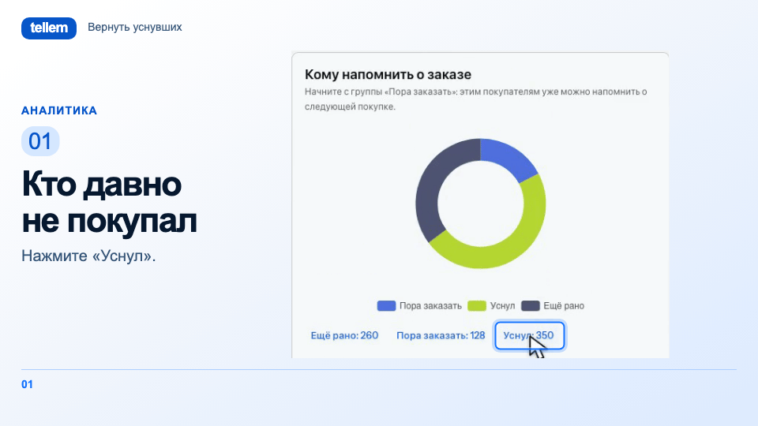
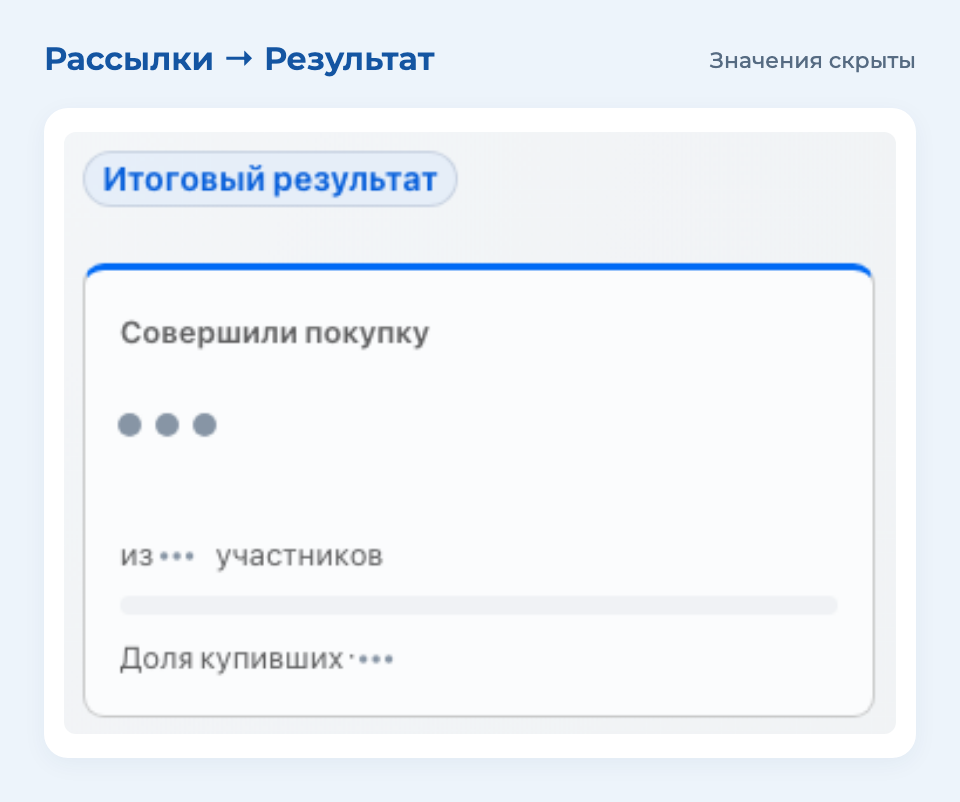
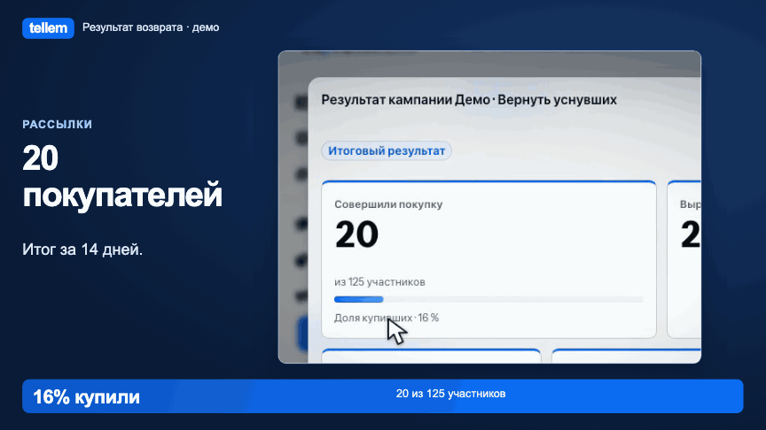

# Вернуть уснувших покупателей { #asleep }

## 1. Найдите тех, кто перестал заказывать { #diagnose }

Откройте **Аналитика → Повторные заказы** и выберите точку. В блоке **«Кому напомнить о заказе»** нажмите на число рядом с **«Уснул»**. Откроется список покупателей.

<figure markdown="span">
[{ width="504" height="475" loading=lazy }](../../../media/crm/repeat-analytics-customer-groups.png){ .glightbox }
<figcaption>Откройте группу «Уснул» в аналитике. При создании сегмента выберите это же состояние.</figcaption>
</figure>

Откройте **«Профиль»** в нескольких [карточках клиентов](../clients.md#customer-record). Посмотрите, когда они заказывали в последний раз и какие товары предпочитают. Так вы подберёте повод вернуться.

???+ example "Посмотреть, как открыть список и проверить последний заказ"

    <figure markdown="span">
    [{ width="864" height="486" loading=lazy }](../../../media/crm/repeat-asleep-audience.gif)
    </figure>

## 2. Напомните о знакомом товаре { #launch }

1. В **Аналитика → Сегменты → Создать сегмент** выберите ту же точку и состояние повторной покупки **«Уснул»**. Чтобы вернуть прежних постоянных покупателей, в поле **«Количество заказов: от»** укажите два. Сохраните сегмент.
2. В **Маркетинг → Рассылки → Создать** укажите цель **«Возврат неактивных клиентов»**. В поле **«Сегменты»** выберите свою группу из **«Сохранённых»**.
3. Добавьте ссылку на товар. Если предлагаете скидку, укажите срок действия [промокода](../promo-codes.md#promo-codes). Проверьте, кому уйдёт сообщение, и [запланируйте рассылку](index.md#prepare-campaign).

## 3. Проверьте, вернулись ли покупатели { #review }

В **Маркетинг → Рассылки** выберите кампанию и нажмите **«Результат»**. Когда появится **«Итоговый результат»**, посмотрите **«Долю купивших»**. Сравните её с [прошлой рассылкой](index.md#read-result) для уснувших покупателей за такой же срок.

<figure markdown="span">
[{ width="504" height="421" loading=lazy }](../../../media/crm/repeat-report-buyer-share.png){ .glightbox }
<figcaption>Клиент, который вернулся несколько раз, учитывается в доле купивших один раз.</figcaption>
</figure>

- **Доля купивших выросла.** Повторите предложение для следующей группы уснувших покупателей.
- **Доля осталась прежней или снизилась.** Проверьте **«Посетили магазин»**. Если люди приходили, но редко покупали, проверьте наличие товара и доступность обещанной скидки.

???+ example "Посмотреть, где в отчёте видны вернувшиеся покупатели"

    <figure markdown="span">
    [{ width="864" height="486" loading=lazy }](../../../media/crm/repeat-asleep-result.gif)
    </figure>
