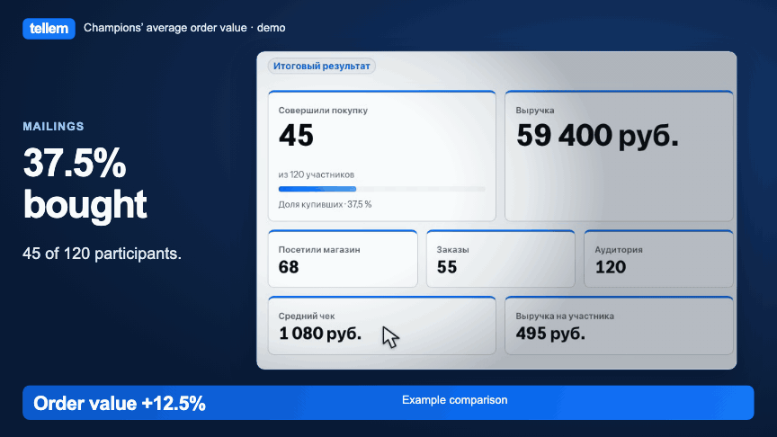

# Increase average order value for Champions { #champions }

Look at what your regular customers buy. Suggest two items they can order together and review how order value, order count, and the share of buyers change.

## 1. Review Champions' purchases { #diagnose }

1. Open **Analytics → Customers** and select one location. Under **“Customer segments”**, click **“Champions”**. The tile shows how many customers are in the segment, their revenue, and their share of revenue.
2. In the customer list, review **“Purchases”** and **“Amount”**. Open a few customer records and take order numbers from the **“Orders”** tab. Find those numbers in the **Orders** section and [review the items](../orders.md#check-the-order). Find a frequently purchased item and pick something that goes with it. For example, suggest coffee beans and chocolate truffles with links to both items.
3. For comparison, record the average order value, order count, share of buyers, and revenue per participant from the final **“Result”** of a past campaign with a comparable audience. The RFM matrix shows amounts over the location's full history. Use equal observation windows when comparing campaigns.

???+ example "Purchases by Champions"

    Demo data. The recording shows the Russian interface.

    <figure markdown="span">
    [{ width="960" height="540" loading=lazy }](../../../media/crm/repeat-champions-audience.en.gif)
    </figure>

## 2. Suggest items to order together { #launch }

1. Under **Marketing → Mailings → Create**, select the same location, **“Standard” → “Champions”**, and **“Increase average order value”**. CRM uses the saved RFM calculation for the location. The tile count and the available recipient count may differ, so review the audience in the campaign.
2. Say why the two items go together, list the prices, and check stock. If you offer a discount, check [how it combines with other discounts](../promo-codes.md#combining-discounts).
3. Check the preview and [schedule the campaign](index.md#prepare-campaign). In this example, both mailings use a **14-day** window.

**Example message**

> Pair your whole coffee beans with chocolate truffles. You can add both to the same cart.

## 3. Compare order value and purchase volume { #review }

After the window closes, open **Marketing → Mailings → Result** for each campaign.

| Metric | Past campaign | Campaign offering two items |
| --- | ---: | ---: |
| Audience | 120 | 120 |
| Made a purchase | 42 | 45 |
| Share of buyers | 35% | 37.5% |
| Orders | 50 | 55 |
| Revenue | ₽48,000 | ₽59,400 |
| Average order value | ₽960 | ₽1,080 |
| Revenue per participant | ₽400 | ₽495 |

???+ example "Comparing average order value"

    Demo data. The recording shows the Russian interface.

    <figure markdown="span">
    [{ width="960" height="540" loading=lazy }](../../../media/crm/repeat-champions-result.en.gif)
    </figure>

In this example, average order value increased by **12.5%** and the share of buyers rose by **2.5 percentage points**. If order value rises as orders fall, check revenue per participant. If you have no comparable campaign yet, keep the first final report as a reference for the next one. [Compare campaign results](index.md#read-result)
