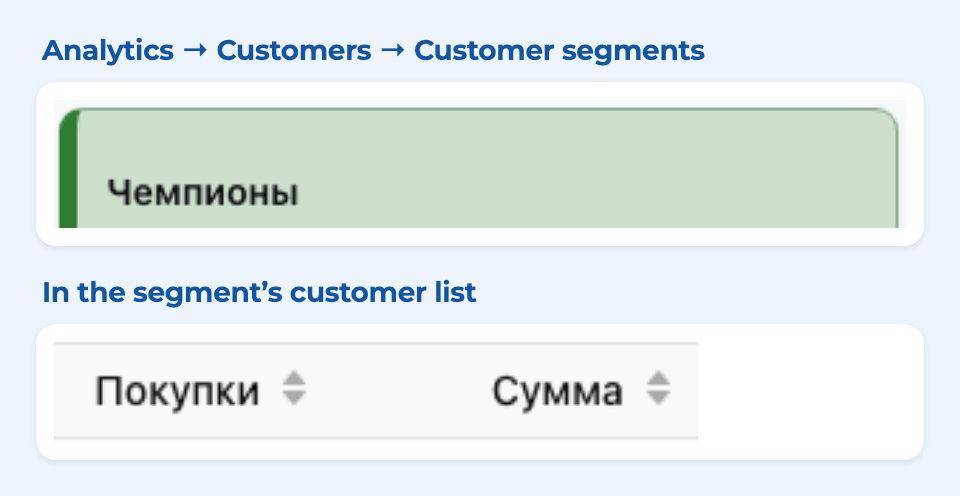
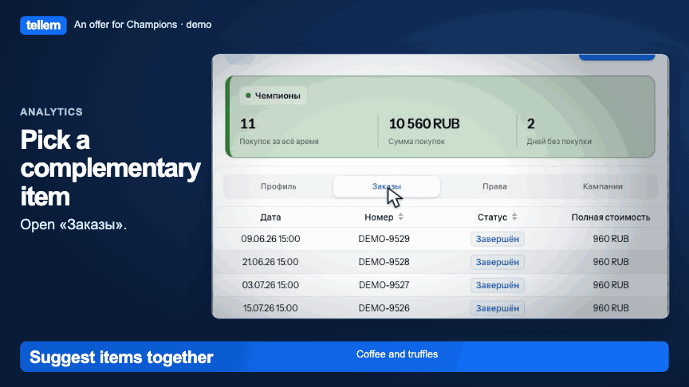
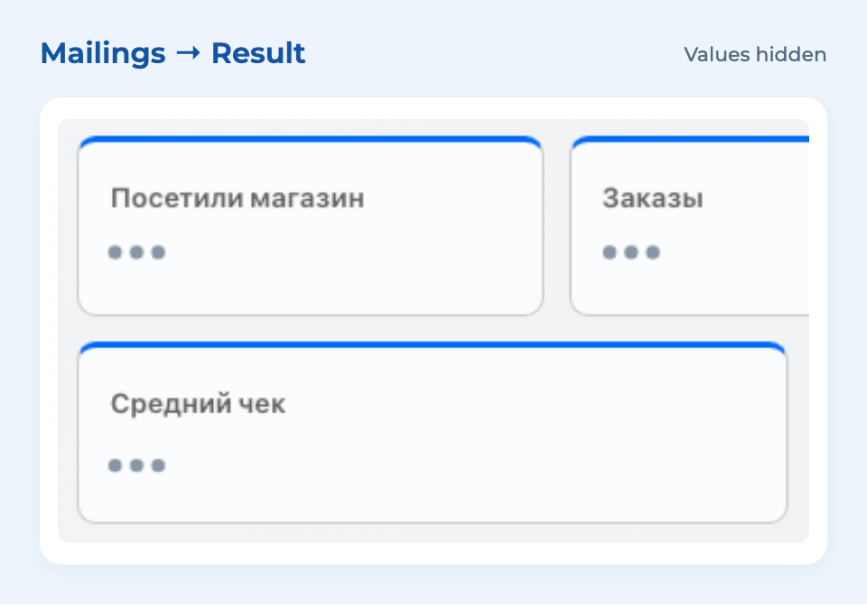

# Increase average order value for Champions { #champions }

## 1. Find out what Champions buy { #diagnose }

Open **Analytics → Customers** and select a location. Under **“Customer segments”**, click **“Champions”**. In the customer list, check the **“Purchases”** and **“Amount”** columns.

<figure markdown="span">
[{ width="504" height="260" loading=lazy }](../../../media/crm/repeat-analytics-champions.en.png){ .glightbox }
<figcaption>Open «Чемпионы» (Champions), then click «Покупки» (Purchases) to sort customers by purchase count.</figcaption>
</figure>

Open **“Orders”** in a customer record. Look up an order by number in the **Orders** section and [review its items](../orders.md#check-the-order). Check a few more orders. Choose a product that goes well with an item you see often.

???+ example "Watch how to find orders from Champions"

    <figure markdown="span">
    [{ width="864" height="486" loading=lazy }](../../../media/crm/repeat-champions-audience.en.gif)
    </figure>

## 2. Suggest an item to add to the order { #launch }

1. Open **Marketing → Mailings → Create**. Choose the same location and the goal **“Increase average order value”**. Under **“Segments”**, choose **“Standard” → “Champions”**.
2. Explain in the message how the products go together. Check stock and include prices and links.
3. Check the audience. Choose the same observation window as your previous mailing to Champions and [schedule the mailing](index.md#prepare-campaign).

## 3. Compare order value and the share of buyers { #review }

Under **Marketing → Mailings**, open **“Result”** for the new and [previous comparable campaign](index.md#read-result). In the final reports, compare **“Average order value”** and **“Share of buyers”**.

<figure markdown="span">
[{ width="504" height="353" loading=lazy }](../../../media/crm/repeat-report-average-check.en.png){ .glightbox }
<figcaption>This is the average amount per order during the observation window.</figcaption>
</figure>

- **Order value rose and the share of buyers held steady or grew.** Buyers spent more per order. Check the order items to see whether people bought the suggested products together. If they did, repeat the offer.
- **Order value stayed flat or fell, or the share of buyers dropped.** Try an item that’s a closer match for the usual purchase or costs less. Check both figures again.

???+ example "Watch how to compare the results of two mailings"

    <figure markdown="span">
    [{ width="864" height="486" loading=lazy }](../../../media/crm/repeat-champions-result.en.gif)
    </figure>
