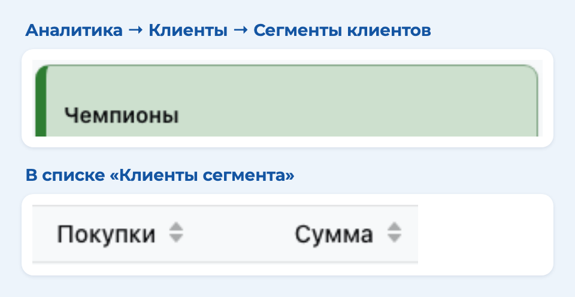
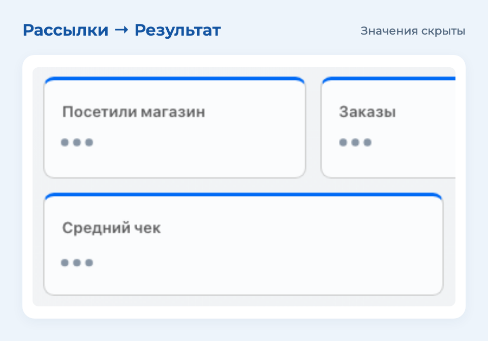

# Поднять средний чек у «Чемпионов» { #champions }

## 1. Посмотрите, что покупают «Чемпионы» { #diagnose }

Откройте **Аналитика → Клиенты** и выберите точку. В блоке **«Сегменты клиентов»** нажмите **«Чемпионы»**. В списке покупателей посмотрите колонки **«Покупки»** и **«Сумма»**.

<figure markdown="span">
[{ width="504" height="260" loading=lazy }](../../../media/crm/repeat-analytics-champions.png){ .glightbox }
<figcaption>После клика на «Чемпионы» откроется список. Нажмите на заголовок «Покупки», чтобы отсортировать клиентов по числу покупок.</figcaption>
</figure>

Откройте **«Заказы»** в карточке покупателя. Найдите заказ по номеру в разделе **«Заказы»** и посмотрите его [состав](../orders.md#check-the-order). Просмотрите ещё несколько заказов. Выберите дополнение к товару, который встречается часто.

???+ example "Посмотреть, как найти заказы «Чемпионов»"

    <figure markdown="span">
    [{ width="864" height="486" loading=lazy }](../../../media/crm/repeat-champions-audience.gif)
    </figure>

## 2. Предложите дополнить заказ { #launch }

1. Откройте **Маркетинг → Рассылки → Создать**. Выберите ту же точку и цель **«Увеличение среднего чека»**. В поле **«Сегменты»** выберите **«Обычные» → «Чемпионы»**.
2. Покажите в сообщении, чем товары дополняют друг друга. Проверьте наличие, добавьте цены и ссылки.
3. Проверьте аудиторию. Для сравнения выберите такое же окно наблюдения, как в прошлой рассылке по «Чемпионам», и [запланируйте отправку](index.md#prepare-campaign).

## 3. Сравните средний чек и долю купивших { #review }

В **Маркетинг → Рассылки** откройте **«Результат»** новой и [прошлой похожей кампании](index.md#read-result). В итоговых отчётах сравните **«Средний чек»** и **«Долю купивших»**.

<figure markdown="span">
[{ width="504" height="353" loading=lazy }](../../../media/crm/repeat-report-average-check.png){ .glightbox }
<figcaption>Здесь видна средняя сумма одного заказа за срок наблюдения.</figcaption>
</figure>

- **Чек вырос, а доля купивших сохранилась или выросла.** Покупатели тратили больше за заказ. Посмотрите по составу заказов, брали ли предложенные товары вместе. Если да, повторите предложение.
- **Чек не вырос или доля купивших снизилась.** Попробуйте другое дополнение — ближе к привычной покупке или доступнее по цене. Снова проверьте оба показателя.

???+ example "Посмотреть, как сравнить итоги двух рассылок"

    <figure markdown="span">
    [{ width="864" height="486" loading=lazy }](../../../media/crm/repeat-champions-result.gif)
    </figure>
