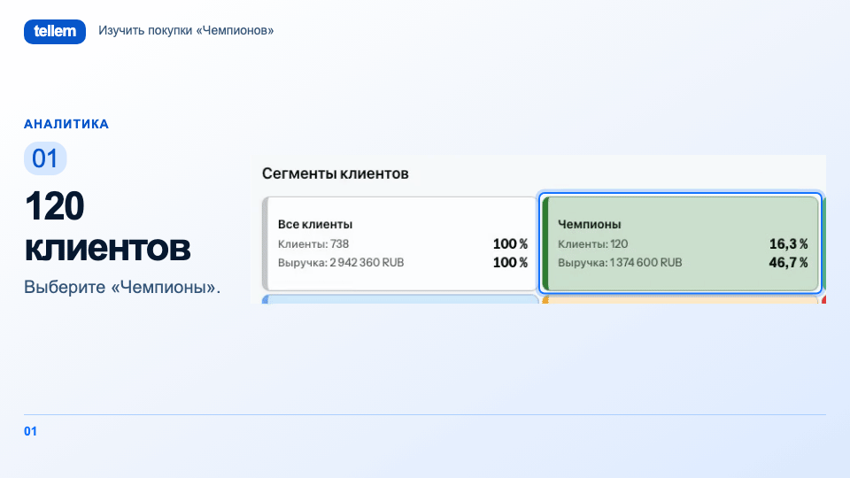
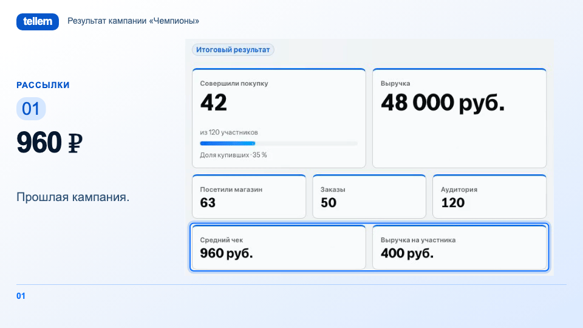

# Поднять средний чек у «Чемпионов» { #champions }

Посмотрите, что выбирают ваши постоянные покупатели. Предложите два товара, которые удобно заказать вместе, и проверьте, как изменились чек, число заказов и доля купивших.

## 1. Изучите покупки «Чемпионов» { #diagnose }

1. Откройте **Аналитика → Клиенты** и выберите одну точку. В блоке **«Сегменты клиентов»** нажмите **«Чемпионы»**. На плитке посмотрите число клиентов, выручку и её долю.
2. В списке клиентов посмотрите колонки **«Покупки»** и **«Сумма»**. Откройте несколько карточек клиентов. Возьмите номера из вкладки **«Заказы»** и проверьте [состав заказов](../orders.md#check-the-order) по этим номерам в разделе **«Заказы»**. Найдите товар, который часто выбирают, и подберите дополнение. Например, предложите кофе в зёрнах и шоколадные трюфели со ссылками на оба товара.
3. Для сравнения запишите средний чек, число заказов, долю купивших и выручку на участника из итогового **«Результата»** прошлой кампании на сопоставимую аудиторию. Матрица RFM показывает суммы за всю историю точки. Для сравнения кампаний возьмите одинаковые окна наблюдения.

???+ example "Покупки «Чемпионов»"

    Демонстрационные данные.

    <figure markdown="span">
    [{ width="960" height="540" loading=lazy }](../../../media/crm/repeat-champions-audience.gif)
    </figure>

## 2. Предложите товары для одной корзины { #launch }

1. В **Маркетинг → Рассылки → Создать** выберите ту же точку, **«Обычные» → «Чемпионы»** и цель **«Увеличение среднего чека»**. CRM использует сохранённый расчёт RFM по точке. Число клиентов на плитке и число доступных получателей могут различаться, поэтому проверьте аудиторию в самой кампании.
2. Напишите, в чём польза пары товаров, укажите цены и проверьте наличие. Если предлагаете скидку, проверьте [правила её сочетания с другими скидками](../promo-codes.md#combining-discounts).
3. Проверьте предпросмотр и [запланируйте кампанию](index.md#prepare-campaign). В примере для обеих рассылок установлено окно **14 дней**.

**Пример сообщения**

> Выберите кофе в зёрнах и добавьте к нему шоколадные трюфели. Оба товара можно заказать в одной корзине.

## 3. Сравните чек и объём покупок { #review }

По окончании окна откройте **Маркетинг → Рассылки → Результат** по каждой кампании.

| Показатель | Прошлая кампания | Кампания с парой товаров |
| --- | ---: | ---: |
| Аудитория | 120 | 120 |
| Совершили покупку | 42 | 45 |
| Доля купивших | 35% | 37,5% |
| Заказы | 50 | 55 |
| Выручка | 48 000 ₽ | 59 400 ₽ |
| Средний чек | 960 ₽ | 1 080 ₽ |
| Выручка на участника | 400 ₽ | 495 ₽ |

???+ example "Сравнение среднего чека"

    Демонстрационные данные.

    <figure markdown="span">
    [{ width="960" height="540" loading=lazy }](../../../media/crm/repeat-champions-result.gif)
    </figure>

В примере средний чек вырос на **12,5%**, доля купивших прибавила **2,5 процентного пункта**. Если чек вырос, а заказов стало меньше, проверьте выручку на участника. Если сравнимой кампании ещё нет, сохраните первый итог как ориентир для следующей. [Как сравнивать результаты](index.md#read-result)
