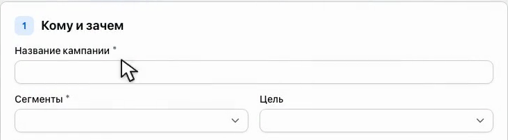

# How to increase repeat purchases { #repeat-purchases }

## Choose a campaign { #choose-a-campaign }

Open **Analytics** and select the location you want to run a mailing for.

| What you see | Whom to contact |
| --- | --- |
| In the repeat purchase funnel, many customers stop after their first order. | [Help them place a second order](second-order.md). |
| Customers in the “Due” group have reached their usual reorder date. | [Remind them about an item they buy](reorder.md). |
| Customers who used to buy regularly appear in the “Asleep” group. | [Give them a reason to return](asleep.md). |
| Champions often buy items that go well with something else you sell. | [Suggest items to order together](champions.md). |

## Send the mailing { #prepare-campaign }

1. Open **Marketing → Mailings → Create**. Under **“Audience and goal”**, name the campaign and select the location, segment and goal for your case.

    <figure markdown="span">
    [{ width="732" height="202" loading=lazy }](../../../media/crm/repeat-campaign-form.png){ .glightbox }
    <figcaption>In the Russian interface, «Сегменты» sets the audience and «Цель» sets the campaign goal.</figcaption>
    </figure>

2. Under **“Message”**, choose the channel and write the offer. Check the link in the preview. Below it, review how many people you can contact. Open **“Excluded”** to see why others will miss the mailing. [Consent for mailings](../mass-mailings.md#recipients)
3. Under **“Schedule”**, set the date and **“Observation window”**. To compare with a previous campaign, use the same window length. Click **“Schedule campaign”** and confirm.

???+ example "How to check the audience before sending"

    <figure markdown="span">
    [{ width="864" height="486" loading=lazy }](../../../media/crm/repeat-campaign-audience.en.gif)
    </figure>

## Compare the results { #read-result }

In **Marketing → Mailings**, select the sent campaign and click **“Result”**. Wait for **“Final result”**.

Open the report for a previous mailing at the same location, with a similar audience, the same channel and the same observation window. Each case explains which metrics to compare. If this is your first comparable mailing, save its result for next time.

The report counts purchases by all participants during the window. Some may have bought without a message. [How CRM calculates the result](../mass-mailings.md#campaign-result)
