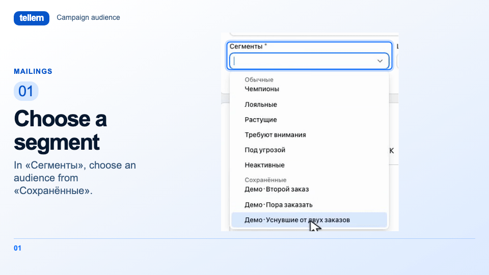

# How to increase repeat purchases { #repeat-purchases }

Choose one location and open **Analytics → Repeat orders** or **Analytics → Customers**. Start with the metric you want to change.

| What you see in analytics | Which campaign to run |
| --- | --- |
| Many customers buy once. Few move from the first order to the second in the funnel. | [Encourage a second order](second-order.md) |
| Customers with multiple orders are past their usual purchase interval and appear under “Asleep”. | [Win back lapsed customers](asleep.md) |
| “Champions” buy often, and their order history can help you pick products that go together. | [Increase average order value for Champions](champions.md) |
| Regular buyers are due for another order and appear under “Due”. | [Send a reorder reminder](reorder.md) |

## Prepare the campaign { #prepare-campaign }

1. In **Marketing → Mailings**, click **“Create”**. You need owner permissions to launch a campaign.
2. Under **“Audience and goal”**, set the point, goal, and segment from the case. Use the point you reviewed in analytics. In **“Segments”**, choose the relevant group under **“Standard”** or **“Saved”**.
3. Under **“Message”**, select a channel. Check how many recipients are available and why others are excluded. For promotional messages, check your customers’ [advertising consent](../mass-mailings.md#recipients).
4. Add your message, then check the offer and link in the preview. Under **“Schedule”**, set the date and the observation window from the case. Click **“Schedule campaign”** and confirm. The [mailing guide](../mass-mailings.md#create-and-send) covers channels and sending in more detail.

???+ example "Reviewing the audience before sending"

    Demo data. The recording shows the Russian interface.

    <figure markdown="span">
    [{ width="960" height="540" loading=lazy }](../../../media/crm/repeat-campaign-audience.en.gif)
    </figure>

## Review the result { #read-result }

1. After the window closes, select the sent campaign in **Marketing → Mailings** and click **“Result”**. Check that the result is final.
2. Check **“Audience”** and **“Share of buyers”**, then the metric from your case. For average order value, also check **“Orders”** and **“Revenue per participant”**.
3. Compare with a previous campaign for the same location and with a comparable audience, channel, and window. If this is your first campaign, use its final result as a baseline for the next one.

The report shows purchases by the audience recorded at launch for the selected location. It includes the entire send day, including purchases before the mailing. If you can randomly split your target audience in advance, send the message to one group. Then compare the share of buyers in both groups over the same period outside the campaign report. The mailing guide explains [how CRM calculates each metric](../mass-mailings.md#campaign-result).
