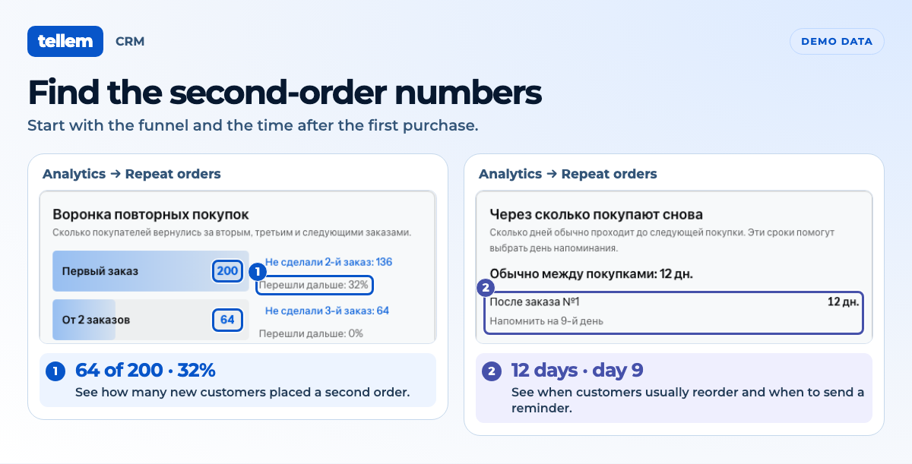
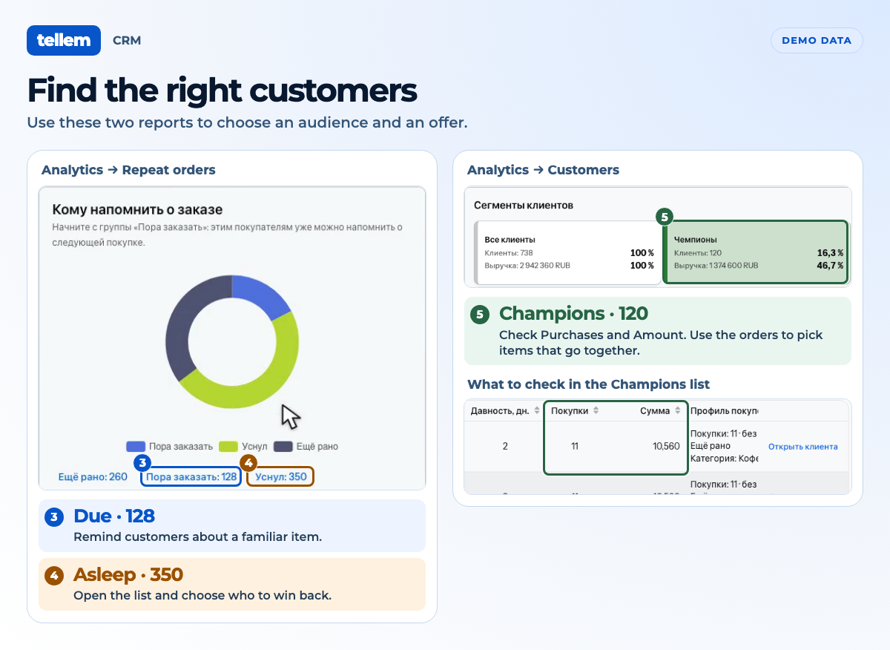

# How to increase repeat purchases { #repeat-purchases }

## Where to look in analytics { #choose-a-campaign }

Open **Analytics** and choose one location. Use the report to decide whom to contact and what to say.

| Where to look | Which campaign to run |
| --- | --- |
| **Repeat orders → Repeat purchase funnel**. Compare “First order” and “2 or more orders”. | [Encourage a second order](second-order.md) if few new customers come back. |
| **Repeat orders → Who to remind**. Find the count next to “Due”. | [Send a reorder reminder](reorder.md) when customers are due to buy again. |
| **Repeat orders → Who to remind**. Find the count next to “Asleep”. | [Win back lapsed customers](asleep.md) if regular customers have gone a long time without buying. |
| **Customers → Customer segments**. Open “Champions” and review their purchases. | [Increase average order value for Champions](champions.md) if you can suggest items that go together. |

???+ example "Where to find the second-order numbers"

    Open **Analytics → Repeat orders**. In this example, 64 of 200 new buyers placed a second order. The card next to the funnel suggests a reminder on day nine. Click the image to zoom in. The screenshots show the Russian interface.

    <figure markdown="span">
    [{ width="1200" height="611" loading=lazy }](../../../media/crm/repeat-analytics-second-order.en.png){ .glightbox }
    </figure>

???+ example "Where to find customers for a mailing"

    Use the count in analytics to estimate the group size. CRM shows how many customers you can contact when you create the mailing. The screenshots show the Russian interface.

    <figure markdown="span">
    [{ width="1200" height="876" loading=lazy }](../../../media/crm/repeat-analytics-customer-groups.en.png){ .glightbox }
    </figure>

## Prepare the campaign { #prepare-campaign }

1. Open **Marketing → Mailings → Create**. Under **“Audience and goal”**, select the location you reviewed in analytics and set the goal and **“Segments”** from the case.
2. Under **“Message”**, choose a channel and add your message. Check the offer and link in the preview. Below the preview, check how many customers you can contact. **“Excluded”** shows why the others cannot receive the message. For advertising, check your customers’ [consent](../mass-mailings.md#recipients).
3. Under **“Schedule”**, set the date and the **“Observation window”** from the case. This is how many days of purchases CRM shows. Click **“Schedule campaign”** and confirm. [More about sending a campaign](../mass-mailings.md#create-and-send)

???+ example "Reviewing the audience before sending"

    Demo data. The recording shows the Russian interface.

    <figure markdown="span">
    [{ width="864" height="486" loading=lazy }](../../../media/crm/repeat-campaign-audience.en.gif)
    </figure>

## Review the result { #read-result }

1. When the observation window ends, select the mailing in **Marketing → Mailings** and click **“Result”**. Wait for **“Final result”**.
2. First check **“Audience”** and **“Share of buyers”** to see how many customers were included and what share placed an order. Then check the metric in your case.
3. Compare with an earlier mailing at the same location, with a similar audience, the same channel, and the same number of days. For a first campaign, note its result for next time.

CRM counts purchases by campaign participants at the selected location over the full window, including the entire send day. An order placed in the morning appears in the report for a mailing sent that evening. Some customers may have bought anyway. [How CRM calculates the metrics](../mass-mailings.md#campaign-result)
