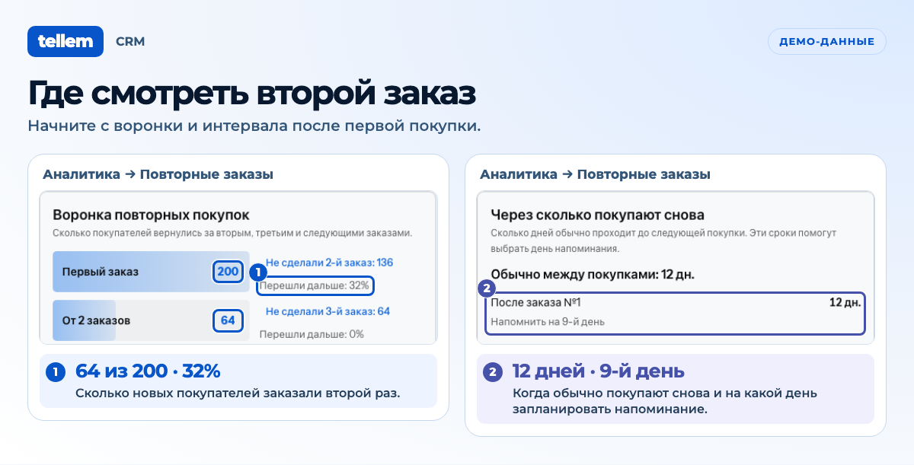
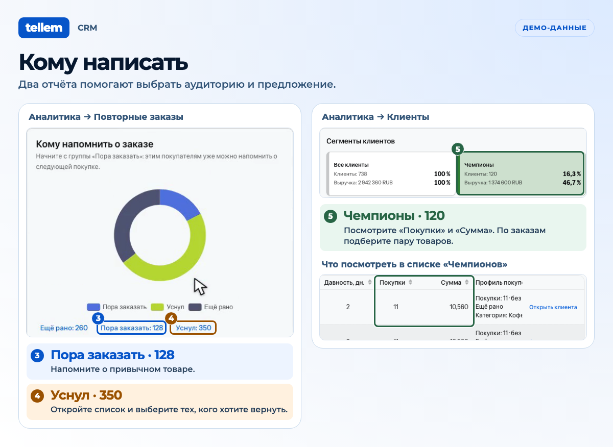
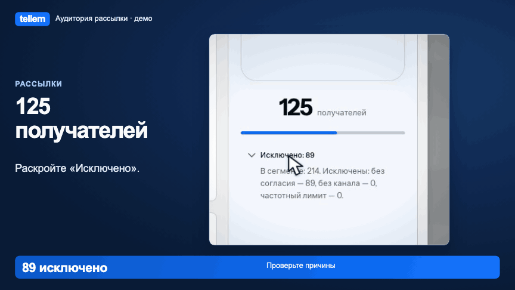

# Как увеличить повторные покупки { #repeat-purchases }

## Что посмотреть в аналитике { #choose-a-campaign }

Откройте раздел **«Аналитика»** и выберите одну точку. По отчёту решите, кому и зачем написать.

| Где смотреть | Какую кампанию выбрать |
| --- | --- |
| **Повторные заказы → Воронка повторных покупок**. Сравните «Первый заказ» и «От 2 заказов». | [Довести до второго заказа](second-order.md), если мало новых покупателей возвращается. |
| **Повторные заказы → Кому напомнить о заказе**. Найдите число рядом с «Пора заказать». | [Напомнить о повторном заказе](reorder.md), когда пришло время очередной покупки. |
| **Повторные заказы → Кому напомнить о заказе**. Найдите число рядом с «Уснул». | [Вернуть уснувших](asleep.md), если постоянные покупатели давно не заказывали. |
| **Клиенты → Сегменты клиентов**. Откройте «Чемпионы» и посмотрите их покупки. | [Повысить средний чек у «Чемпионов»](champions.md), если можете предложить товары, которые удобно заказать вместе. |

???+ example "Где смотреть второй заказ"

    Откройте **Аналитика → Повторные заказы**. В примере 64 из 200 новых покупателей сделали второй заказ. В соседнем блоке CRM предлагает напомнить на 9-й день. Нажмите на изображение, чтобы увеличить его.

    <figure markdown="span">
    [{ width="1200" height="611" loading=lazy }](../../../media/crm/repeat-analytics-second-order.png){ .glightbox }
    </figure>

???+ example "Где найти группы для рассылки"

    По числу в отчёте оцените размер группы. Скольким клиентам можно отправить сообщение, CRM покажет при создании рассылки.

    <figure markdown="span">
    [{ width="1200" height="876" loading=lazy }](../../../media/crm/repeat-analytics-customer-groups.png){ .glightbox }
    </figure>

## Подготовить кампанию { #prepare-campaign }

1. Откройте **Маркетинг → Рассылки → Создать**. В блоке **«Кому и зачем»** выберите ту же точку, что в аналитике, и укажите цель и **«Сегменты»** из кейса.
2. В блоке **«Сообщение»** выберите канал и добавьте текст. В предпросмотре проверьте предложение и ссылку. Под ним посмотрите, скольким клиентам можно отправить сообщение. В **«Исключено»** указано, почему остальным отправить его нельзя. Для рекламы проверьте [согласие клиентов](../mass-mailings.md#recipients).
3. В блоке **«Отправка»** выберите дату и **«Окно наблюдения»** из кейса. Это срок, за который CRM покажет покупки. Нажмите **«Запланировать»** и подтвердите отправку. [Подробнее об отправке](../mass-mailings.md#create-and-send)

???+ example "Проверка аудитории перед отправкой"

    Демонстрационные данные.

    <figure markdown="span">
    [{ width="864" height="486" loading=lazy }](../../../media/crm/repeat-campaign-audience.gif)
    </figure>

## Разобрать результат { #read-result }

1. Когда истечёт срок наблюдения, выберите рассылку в **Маркетинг → Рассылки** и нажмите **«Результат»**. Дождитесь отметки **«Итоговый результат»**.
2. Сначала посмотрите **«Аудитория»** и **«Доля купивших»**. Эти поля показывают, сколько клиентов участвовало в рассылке и какая доля сделала заказ. Затем проверьте показатель из кейса.
3. Сравните с прошлой рассылкой по той же точке, с похожей аудиторией, тем же каналом и числом дней. Если это первая кампания, запишите её итог для следующего сравнения.

CRM учитывает покупки участников в выбранной точке за весь срок, включая весь день отправки. Например, утренний заказ попадёт в отчёт вечерней рассылки. Часть клиентов могла купить и без сообщения. [Как считаются показатели](../mass-mailings.md#campaign-result)
