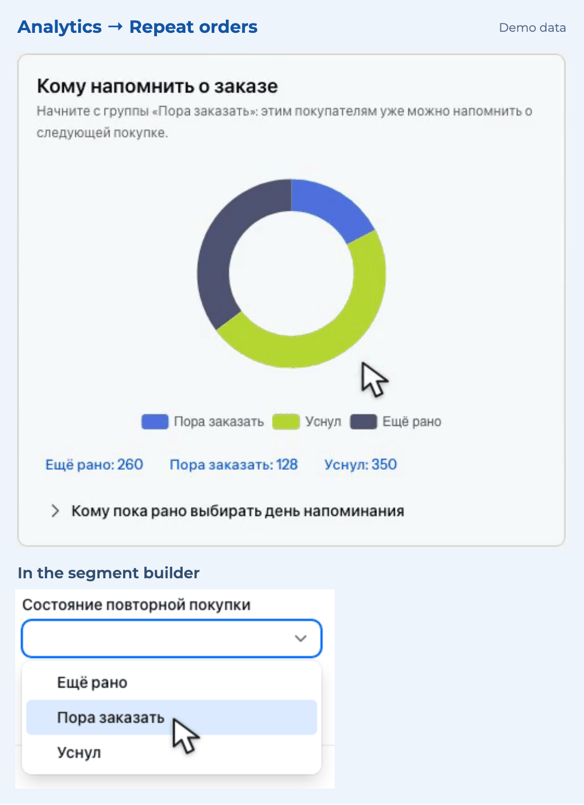
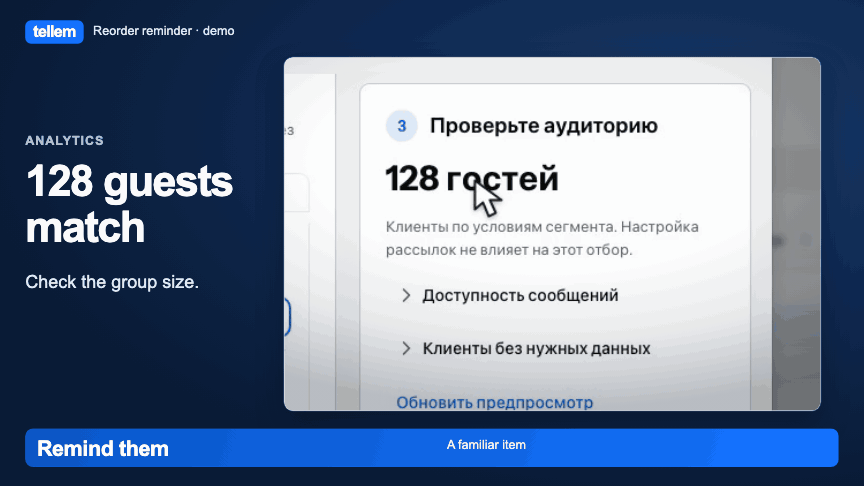
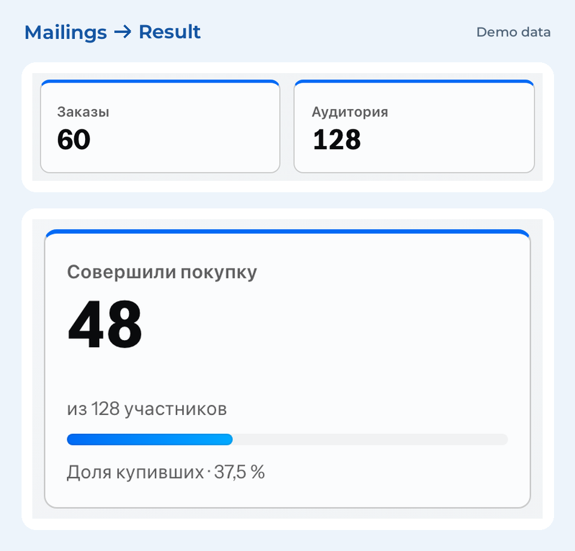

# Send a reminder when customers are due to reorder { #reorder }

## 1. See who is due to reorder { #diagnose }

Open **Analytics → Repeat orders** and select the location. Under **“Who to remind”**, click the count next to **“Due”**. The list shows customers who have reached their usual time to reorder.

<figure markdown="span">
[{ width="504" height="694" loading=lazy }](../../../media/crm/repeat-analytics-customer-groups.en.png){ .glightbox }
<figcaption>The report and segment builder both use «Пора заказать» (Due) for this group.</figcaption>
</figure>

Open **“Profile”** in a few [customer records](../clients.md#customer-record). See what they buy regularly and pick an item that is in stock.

## 2. Send the reminder { #launch }

1. Under **Analytics → Segments → Create segment**, choose the location. Set **“Order count: from”** to **2** and **“Repeat purchase status”** to **“Due”**. For a reminder about a specific item, add **“Favourite product”**. Save the segment.
2. [Create a mailing](index.md#prepare-campaign) for this segment under **“Saved”**. Choose **“Increase purchase frequency”**. Remind customers that they can order the item again, add its link and schedule the mailing.

???+ example "How to build the Due segment"

    <figure markdown="span">
    [{ width="864" height="486" loading=lazy }](../../../media/crm/repeat-reorder.en.gif)
    </figure>

## 3. Check whether people ordered more often { #review }

Under **Marketing → Mailings**, open the final **“Result”**. Divide **“Orders”** by **“Audience”**. Compare orders per participant and **“Share of buyers”** with a [previous mailing](index.md#read-result) to customers who were due to reorder.

<figure markdown="span">
[{ width="504" height="483" loading=lazy }](../../../media/crm/repeat-report-order-frequency.en.png){ .glightbox }
<figcaption>Orders counts purchases by the group. Audience counts everyone in the mailing.</figcaption>
</figure>

**Orders per participant rose and the share of buyers held steady or grew.** Try the same timing with the next group.

**Order frequency did not improve, or the share of buyers fell.** Check **“When customers buy again”**. If customers usually buy later, move the reminder closer to that date.
