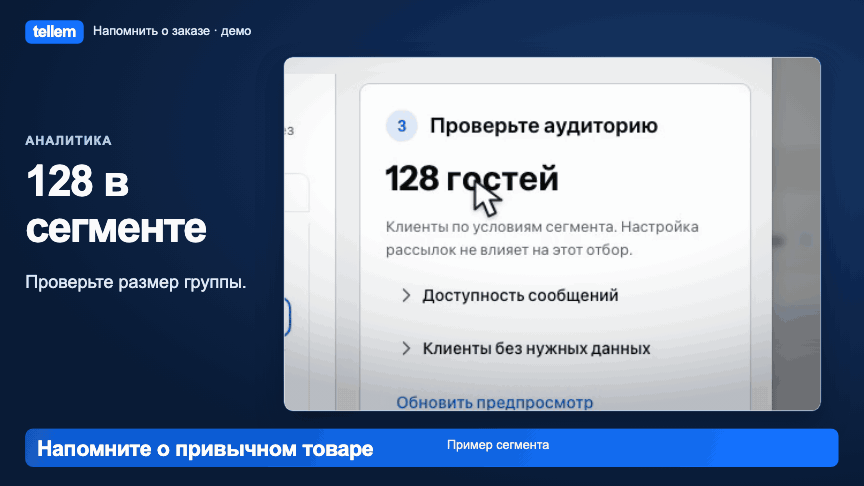

# Напомнить, когда пора заказать снова { #reorder }

## 1. Посмотрите, кому пригодится напоминание { #diagnose }

1. В **Аналитика → Повторные заказы** выберите точку и в блоке **«Кому напомнить о заказе»** нажмите **«Пора заказать»**. Посмотрите, сколько клиентов попали в список.
2. В блоке **«Через сколько покупают снова»** проверьте, сколько дней обычно проходит между заказами. Посмотрите любимые товары в **«Профиле»** нескольких [клиентов](../clients.md#customer-record). Выберите товар, который есть в наличии.

## 2. Сохраните сегмент и запланируйте напоминание { #launch }

1. В **Аналитика → Сегменты → Создать сегмент** выберите ту же точку. Укажите **2** в поле **«Количество заказов: от»**. В **«Состоянии повторной покупки»** выберите **«Пора заказать»**.
2. Если напоминание касается одной категории или товара, добавьте **«Любимая категория»** или **«Любимый товар»**. Проверьте размер аудитории и сохраните сегмент «Пора повторить заказ».
3. [Создайте рассылку](index.md#prepare-campaign) на этот сегмент из группы **«Сохранённые»**. Цель **«Увеличение частоты покупок»**, окно **7 дней**. Напомните о привычном товаре и добавьте ссылку.

**Пример сообщения**

> Заканчивается кофе? Кофе в зёрнах есть в наличии.

???+ example "Сегмент «Пора заказать»"

    Демонстрационные данные.

    <figure markdown="span">
    [{ width="864" height="486" loading=lazy }](../../../media/crm/repeat-reorder.gif)
    </figure>

## 3. Сопоставьте долю купивших и число заказов { #review }

После закрытия окна выберите рассылку и откройте **«Результат»**. В примере из **128 участников** купили **48** (**37,5%**). Они сделали **60 заказов**, или **0,47 заказа на участника**. Для расчёта разделите **«Заказы»** на **«Аудиторию»**, округлив результат до сотых.

Сравните с [похожей рассылкой](index.md#read-result). Если заказов на участника стало больше, проверьте, как изменилась доля купивших.
