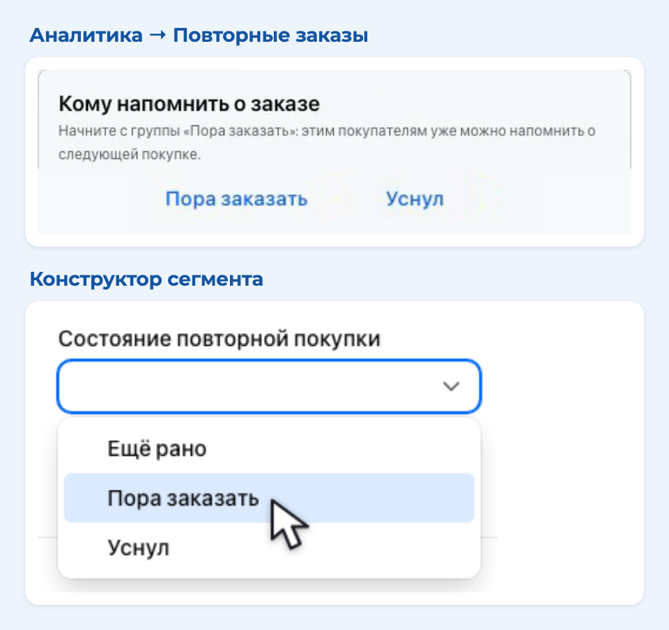
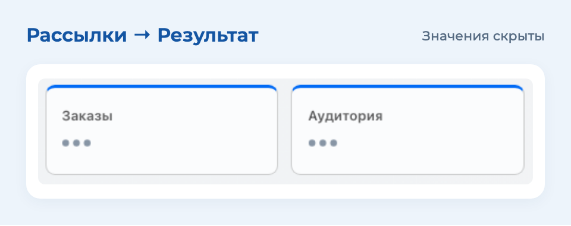

# Напомнить, когда пора заказать снова { #reorder }

## 1. Узнайте, кому пора напомнить { #diagnose }

Откройте **Аналитика → Повторные заказы** и выберите точку. В блоке **«Кому напомнить о заказе»** нажмите число рядом с **«Пора заказать»**. В списке будут клиенты, у которых подошёл привычный срок следующей покупки.

<figure markdown="span">
[{ width="504" height="475" loading=lazy }](../../../media/crm/repeat-analytics-customer-groups.png){ .glightbox }
<figcaption>В отчёте нажмите «Пора заказать». При создании сегмента выберите то же состояние в списке.</figcaption>
</figure>

Откройте **«Профиль»** в нескольких [карточках клиентов](../clients.md#customer-record). Посмотрите, что покупают регулярно, и выберите товар в наличии.

## 2. Отправьте напоминание { #launch }

1. В **Аналитика → Сегменты → Создать сегмент** выберите точку. В поле **«Количество заказов: от»** укажите **2**, а в **«Состояние повторной покупки»** выберите **«Пора заказать»**. Если пишете об одном товаре, добавьте условие **«Любимый товар»**. Сохраните сегмент.
2. [Создайте рассылку](index.md#prepare-campaign) для этого сегмента из группы **«Сохранённые»**. Выберите цель **«Увеличение частоты покупок»**. Напомните, что привычный товар можно заказать снова, добавьте ссылку и запланируйте отправку.

???+ example "Как собрать сегмент «Пора заказать»"

    <figure markdown="span">
    [{ width="864" height="486" loading=lazy }](../../../media/crm/repeat-reorder.gif)
    </figure>

## 3. Проверьте, стали ли заказывать чаще { #review }

Откройте итоговый **«Результат»** в **Маркетинг → Рассылки**. Разделите **«Заказы»** на **«Аудиторию»**. Сравните число заказов на участника и **«Долю купивших»** с [прошлой рассылкой](index.md#read-result) для тех, кому пора заказать.

<figure markdown="span">
[{ width="504" height="200" loading=lazy }](../../../media/crm/repeat-report-order-frequency.png){ .glightbox }
<figcaption>«Заказы» показывают все покупки группы, «Аудитория» — всех участников рассылки.</figcaption>
</figure>

**Заказов на участника стало больше, а доля купивших сохранилась или выросла.** Попробуйте этот срок напоминания для следующей группы.

**Частота не выросла или доля купивших снизилась.** Сверьтесь с блоком **«Через сколько покупают снова»**. Если клиенты обычно заказывают позже, сдвиньте напоминание.
