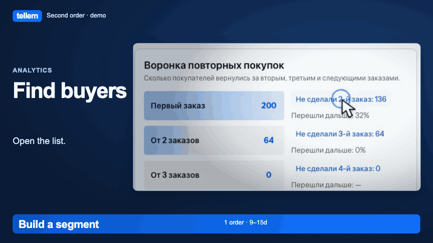

# Get customers to place a second order { #second-order }

If many customers buy only once, look at the transition from the first to the second order. The funnel shows how many customers are at each step. The time between purchases helps you choose when to send a reminder.

## 1. Find the transition from first to second order { #diagnose }

1. Under **Analytics → Repeat orders**, select a location and date range. Choose a past range in which most new buyers had time to order again.
2. In **“Repeat purchase funnel”**, compare the first two steps. In this example, 64 of 200 customers made a second purchase, a transition rate of **32%**. Click **“No order #2 yet”** to open the customer list.
3. In **“When customers buy again”**, find **“After order #1”**. In this example, the median is **12 days** and the recommendation is **“Remind on day 9”**. If there are too few repeat purchases and CRM hides the interval, start with the location's order history.

???+ example "From first to second order"

    Demo data. The recording shows the Russian interface.

    <figure markdown="span">
    [{ width="960" height="540" loading=lazy }](../../../media/crm/repeat-second-order.en.gif)
    </figure>

## 2. Build the segment and launch the campaign { #launch }

1. Open **Analytics → Segments → Create segment** and select the same location. Set both **“Order count: from”** and **“Order count: to”** to **1**.
2. For this example, set **“Days since last order: from”** to **9** and **“Days since last order: to”** to **15**. Review the customer count and save the segment as “Second order”. CRM selects recipients based on these conditions at launch.
3. Under **Marketing → Mailings → Create**, select the same location, “Second order” from **“Saved”**, and **“Increase purchase frequency”**. Remind customers about a popular item that is in stock and include a link. This example uses coffee beans. Review the audience and [schedule the campaign](index.md#prepare-campaign) with a **7-day** window.

**Example message**

> Thanks for your first order! If you're shopping for coffee to brew at home, try our whole beans.

## 3. Check how many participants ordered again { #review }

After the window closes, select the mailing and open **“Result”**. In this example, **24** of **100 participants** made a purchase. The **“Share of buyers”** was **24%**.

Compare 24% with the [final result of a similar campaign](index.md#read-result). The initial 32% is the funnel transition for all first-time buyers in the selected date range. Review this transition separately for later groups of first-time buyers once they have had a similar amount of time to place a second order.
