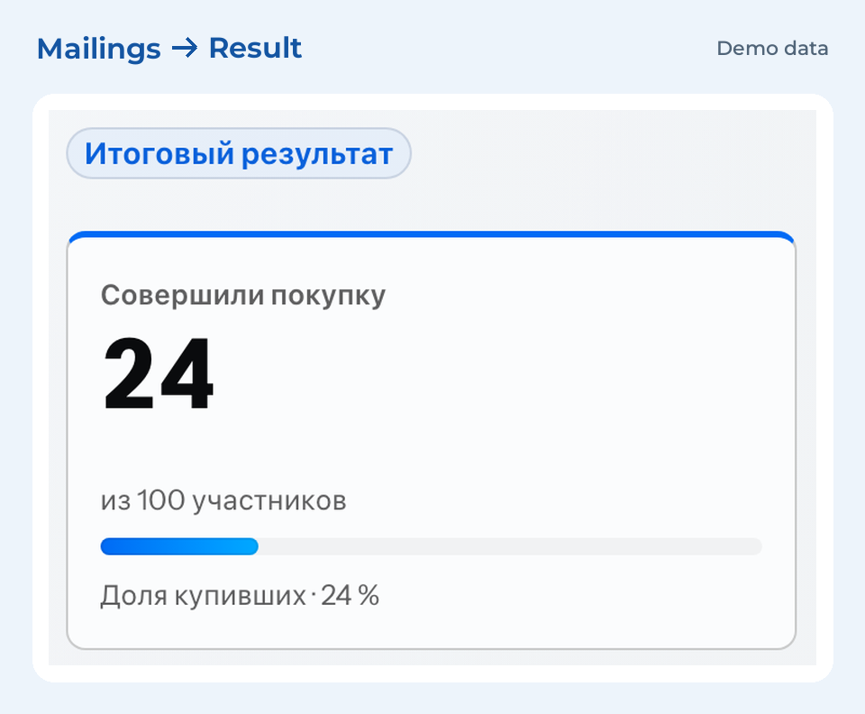

# Get customers to place a second order { #second-order }

## 1. Find customers who bought once { #diagnose }

Open **Analytics → Repeat orders** and select the location. In **“Repeat purchase funnel”**, see how many buyers went on to place a second order. Click **“No order #2 yet”** to open the list of customers who may need a reminder.

<figure markdown="span">
[{ width="504" height="433" loading=lazy }](../../../media/crm/repeat-analytics-second-order.en.png){ .glightbox }
<figcaption>In the Russian interface, «Не сделали 2-й заказ» opens the list. The panel next to the funnel suggests when to remind them.</figcaption>
</figure>

In **“When customers buy again”**, find **“After order #1”**. Use the suggested day to time your reminder. If there is no suggestion yet, look at the time between purchases for customers who have already returned.

???+ example "How to find buyers who may need a reminder"

    <figure markdown="span">
    [{ width="864" height="486" loading=lazy }](../../../media/crm/repeat-second-order.en.gif)
    </figure>

## 2. Send a product reminder { #launch }

1. Under **Analytics → Segments → Create segment**, select the same location. Set both **“Order count: from”** and **“to”** to **1**. Set **“Days since last order”** to a range that includes the reminder day. Save the segment.
2. [Create a mailing](index.md#prepare-campaign). Choose the segment under **“Saved”** and select **“Increase purchase frequency”**. Suggest an item in stock, include its link and schedule the mailing.

## 3. Check who came back { #review }

Open the final report under **Marketing → Mailings → Result**. Compare **“Share of buyers”** with a [previous mailing](index.md#read-result) to people who had bought once. The report counts only the people included in the mailing.

<figure markdown="span">
[{ width="504" height="416" loading=lazy }](../../../media/crm/repeat-report-second-order.en.png){ .glightbox }
<figcaption>In the purchase card, the share who bought again appears below the bar.</figcaption>
</figure>

**The share rose.** A larger share of participants came back for a second order. Try the reminder again with the next group.

**The share stayed flat or fell.** Try a different reminder day next time, keeping the product and channel the same. This helps you check whether the timing suited your buyers.
