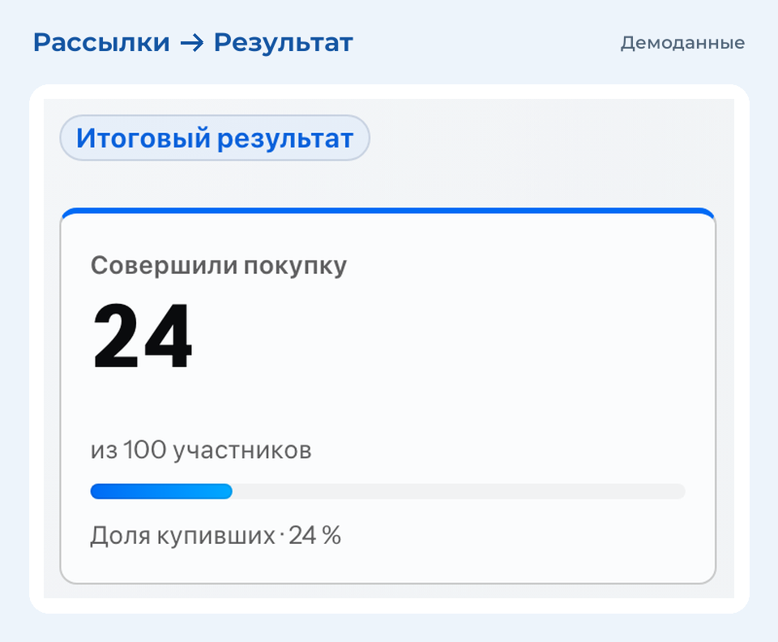

# Довести до второго заказа { #second-order }

## 1. Найдите тех, кто купил только раз { #diagnose }

Откройте **Аналитика → Повторные заказы** и выберите точку. В **«Воронке повторных покупок»** посмотрите, сколько клиентов перешли от первой покупки ко второй. Нажмите **«Не сделали 2-й заказ»**, чтобы открыть список тех, кому пригодится напоминание.

<figure markdown="span">
[{ width="504" height="433" loading=lazy }](../../../media/crm/repeat-analytics-second-order.png){ .glightbox }
<figcaption>Ссылка в воронке открывает список клиентов. В соседнем блоке ищите подсказку о сроке.</figcaption>
</figure>

В блоке **«Через сколько покупают снова»** найдите строку **«После заказа №1»**. По подсказке CRM выберите день для напоминания. Если подсказки пока нет, посмотрите, сколько времени прошло между покупками у тех, кто уже вернулся.

???+ example "Как найти покупателей для напоминания"

    <figure markdown="span">
    [{ width="864" height="486" loading=lazy }](../../../media/crm/repeat-second-order.gif)
    </figure>

## 2. Напомните о товаре { #launch }

1. В **Аналитика → Сегменты → Создать сегмент** выберите ту же точку. В полях **«Количество заказов: от»** и **«до»** укажите **1**. В **«Дней с последнего заказа»** задайте период, на который приходится день напоминания. Сохраните сегмент.
2. [Создайте рассылку](index.md#prepare-campaign). Выберите сегмент в группе **«Сохранённые»** и цель **«Увеличение частоты покупок»**. Предложите товар в наличии, добавьте ссылку и запланируйте отправку.

## 3. Проверьте, вернулись ли покупатели { #review }

В **Маркетинг → Рассылки → Результат** откройте итоговый отчёт. Найдите **«Долю купивших»** и сравните её с [прошлой рассылкой](index.md#read-result) для клиентов с одной покупкой. В отчёте учтены только участники рассылки.

<figure markdown="span">
[{ width="504" height="416" loading=lazy }](../../../media/crm/repeat-report-second-order.png){ .glightbox }
<figcaption>Долю участников, которые купили снова, смотрите под полосой в карточке «Совершили покупку».</figcaption>
</figure>

**Доля выросла.** Больше участников вернулись за вторым заказом. Повторите напоминание для следующей группы.

**Доля прежняя или ниже.** В следующей рассылке измените день напоминания, оставив товар и канал теми же. Так проще проверить, подошёл ли покупателям срок.
