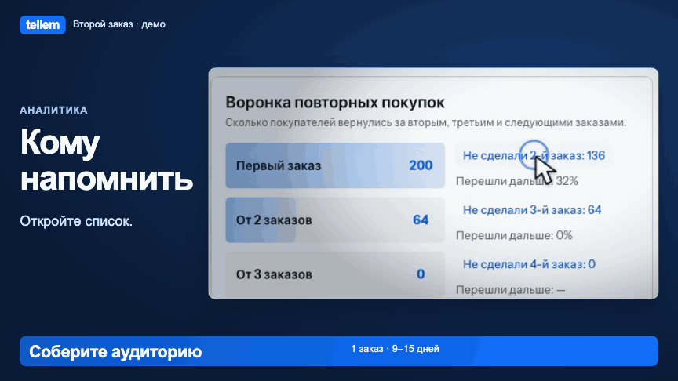

# Довести до второго заказа { #second-order }

## 1. Посмотрите, сколько покупателей вернулось { #diagnose }

1. В **Аналитика → Повторные заказы** выберите точку и прошедший период, в котором у новых покупателей было время заказать снова.
2. В **«Воронке повторных покупок»** сравните первую и вторую ступени. В примере из 200 клиентов 64 сделали второй заказ. Переход составил **32%**. Нажмите **«Не сделали 2-й заказ»**, чтобы открыть список.
3. В блоке **«Через сколько покупают снова»** найдите строку **«После заказа №1»**. В примере покупают снова примерно через **12 дней**, а CRM советует **«Напомнить на 9-й день»**. Если подсказки ещё нет, посмотрите даты первых и вторых покупок в истории заказов.

???+ example "Переход ко второму заказу"

    Демонстрационные данные.

    <figure markdown="span">
    [{ width="864" height="486" loading=lazy }](../../../media/crm/repeat-second-order.gif)
    </figure>

## 2. Соберите сегмент и запустите кампанию { #launch }

1. Откройте **Аналитика → Сегменты → Создать сегмент** и выберите ту же точку. В полях **«Количество заказов: от»** и **«Количество заказов: до»** укажите **1**.
2. В полях **«Дней с последнего заказа: от»** и **«Дней с последнего заказа: до»** укажите **9** и **15** для этого примера. Сохраните сегмент «Второй заказ».
3. [Создайте рассылку](index.md#prepare-campaign). В группе **«Сохранённые»** выберите «Второй заказ». Цель **«Увеличение частоты покупок»**, окно **7 дней**. Добавьте ссылку на популярный товар, который есть в наличии.

**Пример сообщения**

> Спасибо за первый заказ! Если выбираете кофе для дома, попробуйте наш кофе в зёрнах.

## 3. Посчитайте, сколько участников заказали снова { #review }

После закрытия окна выберите рассылку и откройте **«Результат»**. В примере из **100 участников** покупку совершили **24**, а **«Доля купивших»** составила **24%**.

Сравните 24% с [итогом похожей рассылки](index.md#read-result). Воронка показывает **32% среди всех новых покупателей** за выбранный период. Результат рассылки показывает **24% среди её участников**.
